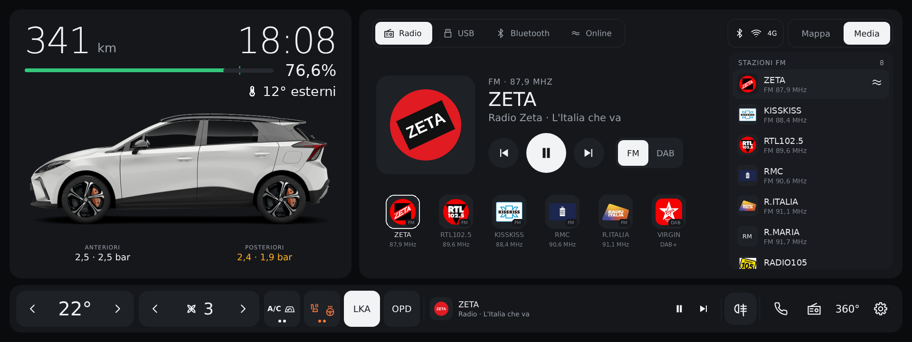
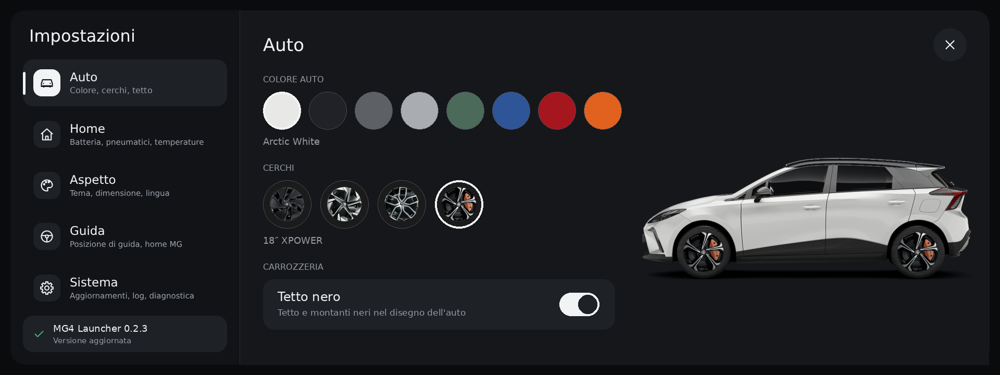
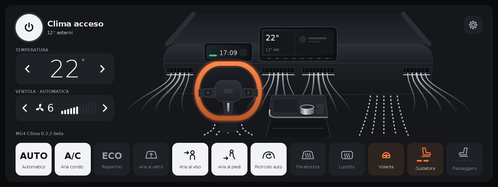
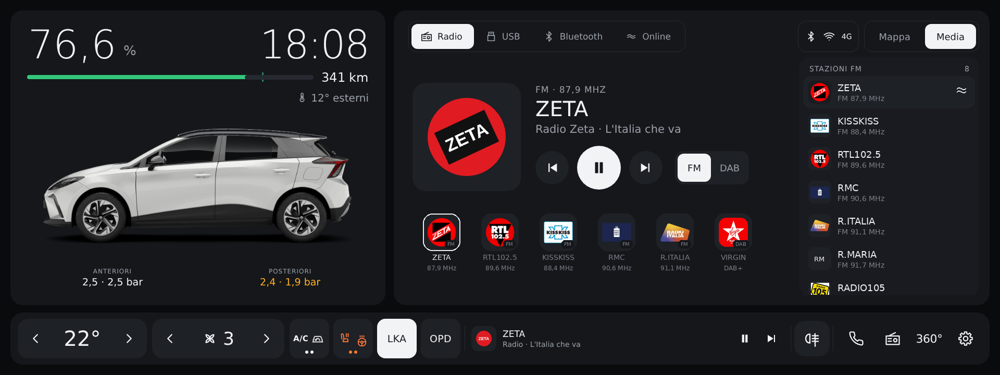

# MG4 Launcher — SWI133 (MG4 Luxury MY24)

🇮🇹 [Italiano](#italiano) · 🇬🇧 [English](#english)

**Ultima versione / Latest version: [0.2.4](releases/MG4Launcher-SWI133-0.2.4.apk)** · 🧪 **sperimentale / experimental**

> 🌡️ **Nuovo: [MG4 Clima](https://github.com/ernestomicco2026-cell/HVAC-Clima-MG4)** — la schermata del clima in stile Tesla, per SWI68, SWI69, SWI132 e SWI133. Con MG4 Clima installato il tasto del clima del launcher apre direttamente quella.
>
> 🌡️ **New: [MG4 Clima](https://github.com/ernestomicco2026-cell/HVAC-Clima-MG4)** — the Tesla-style climate screen, for SWI68, SWI69, SWI132 and SWI133. With MG4 Clima installed the launcher's climate button opens it directly.


[](https://www.paypal.com/pool/9tv7fQ36nA?sr=wccr) [](https://www.paypal.com/pool/9tv7fQ36nA?sr=wccr)

> ⚠️ **Compatibilità / Compatibility:** solo infotainment **SWI133 (nuova MG4 Luxury)** · only **SWI133 (new MG4 Luxury)** infotainment.
> Per gli altri software usa la versione dedicata · for the other software use the dedicated version:
> **SWI68 SAIC 1.0+** → [Mg4-Launcher-SWI68](https://github.com/ernestomicco2026-cell/Mg4-Launcher-SWI68) · **SWI69 Color Radio** → [Mg4-Launcher-SWI69](https://github.com/ernestomicco2026-cell/Mg4-Launcher-SWI69) ·
> **SWI132 (MG4 MY24)** → [Mg4-Launcher-SWI132](https://github.com/ernestomicco2026-cell/Mg4-Launcher-SWI132).

> 🧪 **Versione sperimentale: ho bisogno di voi.** Non ho un'auto con il software SWI133, quindi questa versione non
> l'ho mai potuta provare in auto: l'ho costruita leggendo il firmware `SWI133-29176-1300R36`, partendo dal launcher
> SWI68 0.8.1. **Solo voi che avete questo software potete aiutarmi a migliorarlo.** Se la installate, lasciate attivo
> **Invio log** (è già acceso) oppure mandatemi il log diagnostico (**Salva log** nelle impostazioni) e
> segnalatemi cosa funziona e cosa no.
>
> 🧪 **Experimental version: I need your help.** I don't have a car with SWI133 software, so I have never been able to
> test this version in a car: I built it by reading the `SWI133-29176-1300R36` firmware, starting from the SWI68
> 0.8.1 launcher. **Only those of you who have this software can help me improve it.** If you install it, keep
> **Log upload** on (it is on by default) or send me the diagnostic log (**Save log** in the settings), and tell me
> what works and what doesn't.

> Progetto amatoriale e **non ufficiale**: non è affiliato né approvato da MG Motor o SAIC Motor.
> I nomi MG / MG4 servono solo a indicare l'auto compatibile (infotainment SWI133). Installalo e usalo a tuo rischio.
>
> Hobby project, **not official**: not affiliated with or endorsed by MG Motor or SAIC Motor.
> The MG / MG4 names only identify the compatible car (SWI133 infotainment). Install and use it at your own risk.

---

*Home 0.2.4 con i cerchi 18″ XPOWER · 0.2.4 home with the 18″ XPOWER wheels (mock-up).*


*Impostazioni → Auto: colore, cerchi e tetto · Settings → Car: colour, wheels and roof (mock-up).*


*Home 0.2.2: grafica uguale alla 0.2.1 · 0.2.2 home: same look as 0.2.1 (mock-up).*


*Dalla 0.2.2 il tasto del clima apre [MG4 Clima](https://github.com/ernestomicco2026-cell/HVAC-Clima-MG4), se è installato ·
from 0.2.2 the climate button opens [MG4 Clima](https://github.com/ernestomicco2026-cell/HVAC-Clima-MG4), if installed (mock-up).*


*Home 0.2.1: percentuale della batteria e temperatura più grandi · 0.2.1 home: bigger battery percentage and temperature (mock-up).*


*Home 0.2.1: opzione "Percentuale batteria in grande", km e percentuale invertiti · 0.2.1 home: "Large battery percentage" option, km and percentage swapped (mock-up).*


*Home 0.2.0: grafica identica alla versione SWI68 0.8.3 — gruppi Clima e Comfort, LKA e OPD, lista stazioni e preferiti con logo, nome e frequenza; valori e stazioni sono di esempio · 0.2.0 home: same design as SWI68 version 0.8.3 — Climate and Comfort groups, LKA and OPD, station list and favourites with logo, name and frequency; values and stations are examples (mock-up).*

---

## Video recensione / Video review

<a href="https://youtu.be/JKZ0N3Lr7FI"></a>

Guarda la [video recensione su YouTube](https://youtu.be/JKZ0N3Lr7FI) · Watch the [video review on YouTube](https://youtu.be/JKZ0N3Lr7FI).

---

## Quale versione installare? / Which version should I install?

Ci sono **quattro launcher diversi**, uno per ciascun software dell'infotainment MG4. Non sono intercambiabili:
servizi dell'auto, radio, media e clima sono diversi. Se installi la versione sbagliata, il launcher lo riconosce,
mostra un avviso con il link alla versione giusta e non tenta nessun collegamento all'auto.

| Software dell'auto | Auto | Repository | File APK |
|---|---|---|---|
| **SWI68 SAIC 1.0+** | MG4 | [Mg4-Launcher-SWI68](https://github.com/ernestomicco2026-cell/Mg4-Launcher-SWI68) | `MG4Launcher-X.Y.Z.apk` |
| **SWI69 Color Radio** | MG4 MY23 | [Mg4-Launcher-SWI69](https://github.com/ernestomicco2026-cell/Mg4-Launcher-SWI69) | `MG4Launcher-SWI69-X.Y.Z.apk` |
| **SWI132** | MG4 MY24 | [Mg4-Launcher-SWI132](https://github.com/ernestomicco2026-cell/Mg4-Launcher-SWI132) | `MG4Launcher-SWI132-X.Y.Z.apk` |
| **SWI133** | MG4 Luxury MY24 | **questo repository** | `MG4Launcher-SWI133-X.Y.Z.apk` |

**Come sapere quale software hai:** con il computer collegato all'auto
`adb shell getprop ro.build.mt2712.version` → l'inizio dice il software: `SWI68-…`, `SWI69-…`, `SWI132-…` o `SWI133-…`.
Se il launcher è già installato: impostazioni → riga **MG4 Launcher X.Y.Z · repository** sotto *Aggiornamenti*;
il nome del repository dice quale versione hai.

There are **four different launchers**, one per MG4 infotainment software, and they are not interchangeable. If you
install the wrong one, the launcher recognises it, shows a notice with a link to the right version and does not try to
connect to the car. Check your software with `adb shell getprop ro.build.mt2712.version` (it starts with `SWI68-`, `SWI69-`, `SWI132-` or
`SWI133-`) and use the matching repository above.

---

## Italiano

Launcher in stile Tesla per l'infotainment della **nuova MG4 Luxury** con software **SWI133** (MY24, Android Automotive 9).
È la stessa home della versione SWI68 0.8.1 (grafica, opzioni, testi e lingue identici), adattata ai servizi di questo software.

**Compatibilità:** funziona **solo con il software SWI133**. Con altri software dell'infotainment i servizi dell'auto
sono diversi: il launcher se ne accorge, mostra un avviso con il link alla versione giusta e non si collega all'auto.
**Versione sperimentale:** non l'ho potuta provare in auto; è costruita sul firmware `SWI133-29176-1300R36`. Per
aiutarmi lascia attivo l'invio dei log o mandami il log diagnostico (vedi *Segnalare un problema*).
Per gli altri software ci sono launcher dedicati: **SWI68 SAIC 1.0+** → [Mg4-Launcher-SWI68](https://github.com/ernestomicco2026-cell/Mg4-Launcher-SWI68), **SWI69 Color Radio** → [Mg4-Launcher-SWI69](https://github.com/ernestomicco2026-cell/Mg4-Launcher-SWI69), **SWI132** (MG4 MY24) → [Mg4-Launcher-SWI132](https://github.com/ernestomicco2026-cell/Mg4-Launcher-SWI132).
Sostituisce la schermata home originale mantenendone le funzioni, con una grafica nuova e pulita.

### Cosa fa

- **Auto e batteria** (a sinistra): autonomia e **orologio** in grande, barra batteria con percentuale e tacca del limite di ricarica,
  **data** (facoltativa), stato solo durante ricarica o V2L (tipo, potenza, tempo rimanente), temperatura esterna e interna; sotto l'auto la **pressione degli pneumatici** (TPMS, in bar, kPa o psi) e, se li attivi, i **pulsanti di ricarica**: limite di ricarica, corrente AC e avvia/ferma ricarica o V2L (con conferma). La tua MG4 ricolorabile con gli 8 colori della gamma, tetto nero opzionale.
  Tocca l'auto → Gestione energia. Tienila premuta → impostazioni del launcher.
- **Mappa / Media / CarPlay** (a destra):
  - **Mappa**: indicazioni del navigatore (prossima manovra, via, arrivo). Senza guida: **Dove andiamo?** con la barra
    *Cerca una destinazione*, i riquadri **Casa** e **Lavoro** (se impostati nel navigatore) e la riga **Apri con** (MG, CarPlay/Android Auto se il telefono è collegato, Waze/Google Maps se installati sull'auto).
    Tieni premuto un pulsante della riga per renderlo il navigatore predefinito.
  - **Media**: mostra la sorgente che sta suonando (CarPlay/Android Auto compresi), altrimenti la radio; in alto un pulsante per ogni sorgente
    (Radio, USB, Bluetooth, Online, e CarPlay/Android Auto se il telefono è collegato). Per la radio: logo della stazione,
    pulsanti **FM / DAB** per cambiare banda, **elenco delle stazioni trovate** sulla banda attuale (a destra, tocca per
    sintonizzare) e preferiti FM/DAB con logo, nome e frequenza. I **pacchetti dei loghi
    per paese** si scaricano una volta (paese automatico dal fuso orario, o scelto nelle impostazioni, anche più di uno) e poi
    funzionano senza internet; si installano anche da chiavetta (`MG4Launcher/loghi/IT.zip`). Puoi aggiungere i tuoi
    nella cartella **MG4Launcher/loghi** (memoria o chiavetta USB), un file `nome.png` per stazione con il nome in
    minuscolo, solo lettere e cifre (es. `rtl1025.png`): hanno la priorità.
  - **CarPlay / Android Auto**: la scheda compare da sola quando colleghi il telefono; è una scorciatoia che apre
    CarPlay/Android Auto a schermo intero e, durante la navigazione, mostra la prossima manovra.
- **Barra in basso**: clima con pulsanti grandi da usare in guida — temperatura ‹ › (17 = LO … 33 = HI),
  ventola ‹ › (OFF / 1…11 / A = automatico; tocca l'icona = pannello Clima dell'auto, tieni premuto = accendi/spegni),
  i gruppi **Clima** (A/C, AUTO, ricircolo) e **Comfort** (sedili riscaldati a 3 livelli e volante riscaldato, solo quelli che l'auto ha):
  un tocco apre sopra la barra le caselle grandi, la pressione lunga accende l'A/C o il sedile guida —, i pulsanti **LKA** e **OPD**
  (se l'auto li ha), mini-player, **retronebbia** (si può nascondere; sulla SWI133 i fendinebbia anteriori non sono comandabili),
  Telefono, Radio, **360°**, Impostazioni. Con **Barra grande** i pulsanti diventano più grandi; con *Pulsanti raggruppati* spento torna la barra con i pulsanti separati.
- **In alto a destra**: indicatori di **Bluetooth**, **Wi-Fi** e rete **4G** della T-Box (con le tacche del segnale).
- **App**: scorri la home verso sinistra per le app dell'auto e quelle che installi tu,
  con le icone tutte nello stesso stile; scorri verso destra per tornare. Con **Modifica** scegli quali app installate mostrare.
  Tra le app dell'auto ci sono anche **Impostazioni Android** e **File Android** (se l'auto li ha).
- **Impostazioni** (tieni premuta l'auto): a schermo intero, con un menu di cinque sezioni e la versione con lo stato
  degli aggiornamenti sempre visibile in basso (con **Installa** quando c'è una versione nuova):
  - **Auto**: colore dell'auto (con anteprima) e tetto nero;
  - **Home**: data, percentuale batteria con decimali, pressione pneumatici e sua unità, **temperatura interna** (se l'auto la fornisce), pulsanti di ricarica, barra grande, pulsante retronebbia, pulsanti raggruppati, pulsanti LKA/OPD, **loghi radio** (paese, stato dei pacchetti, Aggiorna, Elimina);
  - **Aspetto**: tema (automatico, notte, giorno), **dimensione dei comandi** (Normale, Grande, Molto grande), **lingua**;
  - **Guida**: **posizione di guida** (come l'auto, sinistra, destra: con la guida a destra la home si specchia e auto e
    clima passano dal lato del guidatore), home originale MG (il navigatore predefinito si sceglie tenendo premuto un
    pulsante della riga *Apri con* nella Mappa);
  - **Sistema**: home predefinita, modalità officina, **Premi Home da solo dopo l'accensione**, **CarPlay e Android Auto** (riavvio del dongle, attesa, *Riavvia CarPlay/AA*), aggiornamenti e avviso, invio automatico dei log, **Salva log**, diagnostica dei servizi.
  Si aprono anche dall'ingranaggio in alto a destra nella pagina App.
- **Schermo intero**: barra di stato e dock MG nascosti (trascina dal bordo per richiamarli).
- **Aggiornamenti**: le nuove versioni si scaricano e si installano dalle impostazioni, senza computer.
- **Lingue**: italiano, inglese, spagnolo, tedesco, portoghese, francese, turco e polacco. Con **Automatica** (predefinita)
  il launcher segue la lingua di sistema dell'auto e cambia da solo quando la cambi; altrimenti scegli la lingua
  nelle impostazioni del launcher. Con una lingua di sistema non tradotta usa l'inglese.

### Installazione

Solo per infotainment **SWI133**. Serve un computer con [adb](https://developer.android.com/tools/releases/platform-tools) collegato all'auto.
Il firmware MG blocca l'installazione normale delle app: l'opzione `-f` la permette.

1. Scarica l'APK dalla cartella [`releases/`](releases/).
2. Installa:
   ```bash
   adb install -r -f MG4Launcher-SWI133-0.2.4.apk
   ```
3. Rendilo la home predefinita:
   ```bash
   adb shell cmd package set-home-activity com.mg4.launcher/.MainActivity
   ```
   In alternativa premi il tasto Home: Android chiede quale home usare.

All'accensione il firmware apre comunque la home MG originale: il launcher se ne accorge e torna in primo piano da solo,
grazie a un servizio di accessibilità che guarda solo quale app è in primo piano,
senza toccare la retrocamera, CarPlay/Android Auto o una chiamata. A ogni avvio riconferma anche di essere la home predefinita.

**Home MG originale e modalità officina** (Impostazioni → Sistema):
- *Usa come home predefinita* spento: la home MG torna quella predefinita, anche all'accensione; il launcher resta
  usabile come app. *Modalità officina* (1, 3 o 7 giorni): per l'assistenza l'auto usa la home MG e gli aggiornamenti
  sono sospesi; alla scadenza il launcher torna da solo, come prima.
- Per rientrare prima: la home MG non mostra MG4 Launcher tra le sue app (ha un elenco fisso), quindi serve un computer:
  `adb shell cmd package set-home-activity com.mg4.launcher/.MainActivity`, poi riaccendi l'interruttore nelle impostazioni.

### Aggiornamenti

Impostazioni del launcher → **Aggiornamenti** → **Controlla aggiornamenti**.
Se c'è una versione più nuova compare **Scarica e installa**: il launcher la installa da solo e si riavvia.
Gli aggiornamenti si possono installare anche da computer, con lo stesso comando dell'installazione.

### Tornare alla home MG originale

Dal launcher: impostazioni → **Apri la home originale MG**. Per renderla di nuovo quella predefinita:

```bash
adb shell cmd package set-home-activity com.saicmotor.hmi.launcher/.ui.MainActivity
```

Per rimuovere del tutto il launcher, anche senza computer (dalla 0.2.1): impostazioni → **Disinstalla MG4 Launcher**.
Rimette la home MG originale e toglie il launcher dall'auto. Da computer: `adb uninstall com.mg4.launcher`.
L'app originale non viene mai modificata.

### Comandi utili

```bash
# riavviare il launcher senza spegnere l'auto
adb shell am force-stop com.mg4.launcher
adb shell am start -n com.mg4.launcher/.MainActivity

# vedere i valori letti dall'auto (Ctrl+C per fermare)
adb logcat -s MG4L MG4L.Link

# scaricare la diagnostica salvata dal launcher (aggiornata ogni 15 s)
adb pull /sdcard/Android/data/com.mg4.launcher/files/diagnostica.txt
```

### Segnalare un problema

In Impostazioni → Sistema, **Diagnostica servizi** fa vedere i valori grezzi letti da ogni servizio
(veicolo, clima, media, radio, CarPlay, navigatore) e gli errori recenti. Uno screenshot di quella pagina
o il file `diagnostica.txt` bastano per capire cosa succede.

I log diagnostici vengono inviati automaticamente in forma anonima, per migliorare il launcher; l'invio si può
disattivare in Impostazioni → Sistema.

Con **Salva log** (in Impostazioni → Sistema) il launcher scrive un log completo — valori, errori, eventi
recenti e logcat del launcher — in `Android/data/com.mg4.launcher/files/mg4-launcher-log-….txt`.
Se è inserita una chiavetta USB il file finisce anche lì, nella stessa cartella: basta aprirla dal computer o dal telefono.

### Sostieni il progetto

MG4 Launcher è e resterà **gratuito**. Se ti è utile e ti va di contribuire alle ore passate a svilupparlo e provarlo
in auto, puoi lasciare un'offerta: è del tutto **volontaria** e **non c'è un importo minimo**, puoi donare quello che
vuoi. Anche una stella al repository o una segnalazione di un problema sono un aiuto prezioso. Grazie!

[](https://www.paypal.com/pool/9tv7fQ36nA?sr=wccr)

### Versioni

#### 0.2.4
- **Ventola su OFF**: l'auto non accetta la ventola a 0 e dopo un attimo la rimetteva a 1. Come nell'app originale,
  la ventola va da 1 in su e OFF ora spegne davvero il clima.

#### 0.2.3
- **Cerchi a scelta** nelle impostazioni (Auto, sotto il colore): 16″ copricerchi neri, 17″ Aero bicolore (di serie),
  18″ Luxury / Trophy e 18″ XPOWER. Si vedono sull'auto della home e nell'anteprima.
- **Temperatura esterna più affidabile**: il launcher controlla il flag di validità del firmware, come il pannello
  originale, e non mostra più valori non validi come -40°.
- **Temperatura interna nascosta**: l'auto non la fornisce con le proprietà standard. Quella chiamata "ambient" è la
  temperatura esterna, che prima con l'opzione accesa si vedeva come interna. Il launcher ora la cerca tra tutte le
  proprietà dell'auto e scrive nei log i valori trovati, per poterla aggiungere in una prossima versione.
- **Dongle CarPlay / Android Auto**: riconosciuti anche quelli che si presentano come un iPhone o un telefono Android
  (es. SmartBox). Se dopo il ritardo non parte nessuna sessione, il dispositivo viene riavviato.
- **Popup delle novità a ogni versione**, con le novità di quella versione.

#### 0.2.2
- **Tasto del clima**: se è installato [MG4 Clima](https://github.com/ernestomicco2026-cell/HVAC-Clima-MG4) apre
  direttamente quello (la nuova schermata del clima in stile Tesla), senza far vedere per un istante il clima originale.
  Senza MG4 Clima tutto resta come prima.

#### 0.2.1
- **La home si apre da sola all'accensione**: dai log di questa versione la home MG arriva spesso *dopo* il launcher
  (fino a 223 secondi dopo), quando il controllo dell'avvio era già finito. Ora, finché la home MG non è comparsa, il launcher la
  aspetta (al massimo 6 minuti) e poi torna davanti; anche *Premi Home da solo* riprova invece di fare un solo
  tentativo. Retrocamera, CarPlay/Android Auto, chiamate e la home MG aperta apposta restano come prima.
- **Niente più crash all'accensione**: prima dello sblocco del sistema le impostazioni del launcher non sono leggibili;
  ora il launcher aspetta lo sblocco invece di chiudersi a ogni avvio.
- **Percentuale batteria in grande** (Impostazioni → Home): inverte km e percentuale.
- **Temperatura interna/esterna e percentuale della batteria più grandi** e più chiare, leggibili durante la guida.
- **Disinstallazione dall'auto**: Impostazioni → Sistema → *Disinstalla MG4 Launcher*. Rimette la home MG originale
  come predefinita e toglie il launcher, senza computer.

#### 0.2.0
Stesse novità della versione SWI68 0.8.2 e 0.8.3, con i servizi della SWI133, verificati sul firmware
`SWI133-29176-1300R36`.
- **Pulsanti raggruppati** nella barra: **Clima** (A/C, AUTO, ricircolo) e **Comfort** (sedili e volante riscaldati,
  solo quelli che l'auto ha). Un tocco apre sopra la barra un riquadro con le caselle grandi (si chiude toccando fuori o
  da solo dopo pochi secondi); i sedili vanno spento → 1 → 2 → 3 → spento. Pressione lunga: A/C o sedile guida.
  Funzionano anche con la barra grande, che ora ha di nuovo il mini player. Si possono spegnere nelle impostazioni
  (*Pulsanti raggruppati*).
- **LKA** (mantenimento corsia) e **OPD** (One Pedal Drive) nella barra, con lo stato reale dell'auto: solo comando
  manuale, nessun automatismo all'avvio. Compaiono solo se l'auto li ha; si possono nascondere.
- **Pacchetti dei loghi radio per paese**, per FM e DAB: si scaricano una volta da questo repository (con controllo
  dell'integrità) e poi funzionano senza internet; paese automatico (dal **fuso orario** dell'auto, poi dalla lingua del
  launcher, confermato dalle stazioni DAB) o scelta di uno o più paesi, *Aggiorna* ed *Elimina* nelle impostazioni,
  installazione da chiavetta. I nomi DAB con `#` davanti e le varianti di una stazione (es. RTL 102.5) trovano il logo.
- **Nome delle stazioni sempre visibile**: nella lista delle stazioni e nei preferiti ci sono sempre logo, nome e
  frequenza (o DAB+). Solo nella copertina grande il logo resta da solo, con il nome accanto.
- **Riavvio del dongle CarPlay/Android Auto** che non si collega: solo con un dongle wireless riconosciuto (mai con un
  telefono via cavo o una chiavetta), al massimo 2 tentativi per accensione, mai durante una chiamata. Attesa
  regolabile e pulsante *Riavvia CarPlay/AA* nelle impostazioni. Sulla SWI133 viene riavviato anche il servizio di
  proiezione MG, così le app dell'auto restano collegate a CarPlay/Android Auto.
- Launcher più leggero: log senza le righe di sistema ripetitive, tolti testi e icone non più usati, immagini dell'auto
  più leggere (identiche), i loghi non sono più dentro l'app.

#### 0.1.0
- Prima versione per **SWI133** (nuova MG4 Luxury), **sperimentale**: stessa grafica, opzioni, testi e lingue della
  versione SWI68 0.8.1, con i servizi verificati sul firmware `SWI133-29176-1300R36`.
- Ricarica, energia, V2L, clima, sedili e volante riscaldati, retronebbia, media, radio, CarPlay/Android Auto,
  navigatore e pressione pneumatici usano gli stessi comandi della SWI68 (verificati uno per uno sul firmware).
- **Clima**: toccando la ventola si apre il pannello Clima dell'auto (sulla SWI133 non è più un'app a parte).
- **Gestione ricarica e Consumi**: aprono la nuova app di ricarica dell'auto, sulla scheda giusta.
- **Fendinebbia anteriori**: sulla SWI133 non sono comandabili, il pulsante non compare.
- **Manuale** e **musica online** (Amazon Music) puntano alle app di questo software.
- Riconosce il software dell'auto (SWI68, SWI69, SWI132 o SWI133): se è quello sbagliato mostra un avviso con il link
  alla versione giusta e non si collega all'auto.
- Log diagnostici nella cartella SWI133 e aggiornamenti da questo repository.

### Compilare

Nessun Gradle: `./build.sh` usa aapt2, javac (bytecode 8), D8 e firma v1+v2 con la chiave platform AOSP
(la stessa del sistema dell'auto, build test-keys). L'APK esce in `build/`. La versione è in `version.properties`.

**Testi e traduzioni:** stanno tutti in `tools/i18n.py` (una riga per testo, 7 lingue). Dopo una modifica:
`python3 tools/i18n.py` rigenera `app/res/values*/strings.xml`, poi `./build.sh`.

Prima di compilare metti in `tools/` i due file non inclusi nel repository:
- `android.jar` (API 28) da [Sable/android-platforms](https://github.com/Sable/android-platforms);
- `d8.jar`: è `lib/jadx-1.5.1-all.jar` di [jadx 1.5.1](https://github.com/skylot/jadx/releases/tag/v1.5.1), rinominato.

`keys/platform.p12` è la chiave platform **pubblica** di test AOSP (password `android`).

**Pubblicare una nuova versione:** aumenta `VERSION_CODE` e `VERSION_NAME` in `version.properties`, compila,
copia l'APK in `releases/`, aggiorna `releases/latest.json` (versione, nome del file e dimensione) e le Versioni
qui sopra, poi commit e push. Il launcher controlla `releases/latest.json` e anche le Release di GitHub
(tag `vX.Y.Z` con l'APK allegato) e propone la più recente.
Per la Release di GitHub basta crearla con il tag `vX.Y.Z`: l'automazione `.github/workflows/allega-apk.yml`
allega da sola `releases/MG4Launcher-SWI133-X.Y.Z.apk` (e, se la descrizione è vuota, usa le note di `latest.json`).

### Come comunica con l'auto

Servizi del software **SWI133** (ricavati dall'analisi del firmware `SWI133-29176-1300R36`; sono gli stessi della SWI68
salvo dove indicato).

| Funzione | Servizio | Note |
|---|---|---|
| Energia, ricarica, V2L | `com.saicmotor.service.vehicle` → hub → `vehiclecharging` | stessi comandi della SWI68 |
| Clima, ventola, temperatura esterna | stesso hub → `aircondition` | temperatura 17–33, ventola 1–11 / auto |
| Pannello Clima | SystemUI `com.android.systemui` (StartActivityService) | come la home MG originale |
| Gestione ricarica e consumi | app `com.saicmotor.hmi.chargesettings` | sulla SWI68 era dentro Impostazioni veicolo |
| Retronebbia | stesso hub → `vehiclesetting` | fendinebbia anteriori non disponibili |
| USB / Bluetooth / Online | `com.saicmotor.service.media` | |
| Radio | `com.saicmotor.service.radio` | FM / AM / DAB, preferiti, logo DAB |
| CarPlay / Android Auto | `com.allgo.rui` + MediaBrowser `com.allgo.remoteui.mediabrowserservice` | metadati e indicazioni |
| Navigatore MG | `com.saicmotor.adapterservice` (GeneralService + notifiche) | |

La mappa del navigatore non può essere mostrata dentro il launcher (è un'altra app):
il pannello Mappa mostra le indicazioni e apre il navigatore a schermo intero.

### Note

- L'immagine dell'auto deriva da una foto ufficiale MG; marchi e immagini appartengono ai rispettivi proprietari.
- I loghi delle stazioni FM vengono da [radio-browser.info](https://www.radio-browser.info), database pubblico e gratuito.

---
## English

Tesla-style launcher for the **new MG4 Luxury** infotainment system running **SWI133** software (MY24, Android Automotive 9).
It is the same home as SWI68 version 0.8.1 (same design, options, texts and languages), adapted to this software's services.

**Compatibility:** works **only with SWI133 software**. Other infotainment software versions use different car
services: the launcher notices, shows a notice with a link to the right version and does not connect to the car.
**Experimental version:** I could not test it in a car; it is built on the `SWI133-29176-1300R36` firmware. To help,
keep log upload on or send me the diagnostic log (see *Reporting a problem*).
For the other software there are dedicated launchers: **SWI68 SAIC 1.0+** → [Mg4-Launcher-SWI68](https://github.com/ernestomicco2026-cell/Mg4-Launcher-SWI68), **SWI69 Color Radio** → [Mg4-Launcher-SWI69](https://github.com/ernestomicco2026-cell/Mg4-Launcher-SWI69), **SWI132** (MG4 MY24) → [Mg4-Launcher-SWI132](https://github.com/ernestomicco2026-cell/Mg4-Launcher-SWI132).
It replaces the original home screen, keeping its features, with a new, clean design.

### Features

- **Car and battery** (left): range and a large **clock**, battery bar with percentage and charge-limit mark, charging and V2L status,
  optional **date**, status only while charging or using V2L (type, power, time left), outside and interior temperature, **tyre pressure** (TPMS, in bar, kPa or psi) under the car and, if enabled, the **charging buttons**: charge limit, AC current and start/stop charging or V2L (with confirmation). Your MG4, recolourable with the 8 factory colours, optional black roof.
  Tap the car → Energy management. Long-press it → launcher settings.
- **Map / Media / CarPlay** (right):
  - **Map**: navigation guidance (next manoeuvre, street, arrival). When not navigating: **Where to?** with the
    *Search for a destination* bar, **Home** and **Work** tiles (if set in the navigator) and the **Open with** row (MG, CarPlay/Android Auto when a phone is connected, Waze/Google Maps if installed on the car).
    Long-press a button in that row to make it the default navigator.
  - **Media**: shows the source that is playing (CarPlay/Android Auto included), otherwise the radio; one button per source at the top
    (Radio, USB, Bluetooth, Online, plus CarPlay/Android Auto when a phone is connected). For the radio: station logo,
    **FM / DAB** buttons to switch band, the **list of stations found** on the current band (on the right, tap to
    tune in) and FM/DAB favourites with logo, name and frequency. **Logo packs per
    country** are downloaded once (automatic country from the time zone, or chosen in settings, even more than one) and then work offline;
    they can also be installed from a USB stick (`MG4Launcher/loghi/IT.zip`). You can add your own in the
    **MG4Launcher/loghi** folder (storage or USB stick), one `name.png` per station, lowercase, letters and digits only
    (e.g. `rtl1025.png`): they take priority.
  - **CarPlay / Android Auto**: the tab appears by itself when you connect a phone; it is a shortcut that opens
    CarPlay/Android Auto full screen and shows the next manoeuvre while navigating.
- **Bottom bar**: climate with large buttons for use while driving — temperature ‹ › (17 = LO … 33 = HI),
  fan ‹ › (OFF / 1…11 / A = auto; tap the icon = car Climate panel, long-press = climate on/off), the **Climate** group (A/C, AUTO,
  recirculation) and the **Comfort** group (3-level heated seats and heated steering wheel, only those the car has): one tap
  opens the big tiles above the bar, a long press turns on A/C or the driver's seat —, **LKA** and **OPD** buttons (if the car has
  them), mini player, **rear fog light** (can be hidden; front fog lights cannot be controlled on SWI133), Phone, Radio, **360°**, Settings.
  With **Large bar** the buttons get bigger; with *Grouped buttons* off you get the bar with separate buttons back.
- **Top right**: **Bluetooth**, **Wi-Fi** and T-Box **4G** indicators (with signal bars).
- **Apps**: swipe the home screen left for the car's apps and the ones you install,
  all with matching icons; swipe right to go back. Use **Modifica** (Edit) to choose which installed apps to show.
  The car apps also include **Android settings** and **Android files** (if the car has them).
- **Settings** (long-press the car): full screen, with a menu of five sections and the version with the update status
  always visible at the bottom (with **Install** when a new version is out):
  - **Car**: car colour (with preview) and black roof;
  - **Home**: date, battery percentage with decimals, tyre pressure and its unit, **interior temperature** (if the car provides it), charging buttons, large bar, rear fog button, grouped buttons, LKA/OPD buttons, **radio logos** (country, pack status, Update, Delete);
  - **Appearance**: theme (auto, night, day), **control size** (Normal, Large, Extra large), **language**;
  - **Driving**: **driving side** (same as car, left, right: with right-hand drive the home is mirrored so the car and
    climate are on the driver's side), original MG home (the default navigator is chosen by long-pressing a button of
    the *Open with* row on the Map);
  - **System**: default home, service mode, **Press Home automatically after power-on**, **CarPlay and Android Auto** (dongle restart, wait, *Restart CarPlay/AA*), updates and update notice, automatic log upload, **Save log**, service diagnostics.
  Also available from the gear at the top right of the Apps page.
- **Full screen**: status bar and MG dock hidden (swipe from the edge to bring them back).
- **Updates**: new versions download and install from the settings, no computer needed.
- **Languages**: Italian, English, Spanish, German, Portuguese, French, Turkish and Polish. **Automatic** (the default)
  follows the car's system language and switches by itself when you change it; otherwise pick a language in the
  launcher settings. If the system language is not translated, English is used.

### Installation

Only for **SWI133** infotainment. You need a computer with [adb](https://developer.android.com/tools/releases/platform-tools) connected to the car.
The MG firmware blocks normal app installs; the `-f` option allows it.

1. Download the APK from the [`releases/`](releases/) folder.
2. Install it:
   ```bash
   adb install -r -f MG4Launcher-SWI133-0.2.4.apk
   ```
3. Make it the default home:
   ```bash
   adb shell cmd package set-home-activity com.mg4.launcher/.MainActivity
   ```
   Or press the Home button: Android asks which home app to use.

At power-on the firmware still opens the original MG home: the launcher notices and comes back to the front by itself,
thanks to an accessibility service that only looks at which app is in the foreground,
without touching the reversing camera, CarPlay/Android Auto or a call. At every start it also re-confirms that it is the
default home.

**Original MG home and service mode** (Settings → System):
- *Use as default home* off: the MG home becomes the default again, also at power-on; the launcher stays usable as an
  app. *Service mode* (1, 3 or 7 days): for servicing, the car uses the MG home and updates are paused; when it expires
  the launcher comes back by itself, as before.
- To come back earlier: the MG home does not list MG4 Launcher among its apps (it has a fixed list), so you need a
  computer: `adb shell cmd package set-home-activity com.mg4.launcher/.MainActivity`, then turn the switch back on.

### Updates

Launcher settings → **Aggiornamenti** (Updates) → **Controlla aggiornamenti** (Check for updates).
If a newer version exists, **Scarica e installa** (Download and install) appears: the launcher installs it and restarts.
Updates can also be installed from a computer with the installation command.

### Going back to the original MG home

From the launcher: settings → **Apri la home originale MG** (Open the original MG home). To make it the default again:

```bash
adb shell cmd package set-home-activity com.saicmotor.hmi.launcher/.ui.MainActivity
```

To remove the launcher completely, even without a computer (since 0.2.1): settings → **Uninstall MG4 Launcher**.
It restores the original MG home and removes the launcher from the car. From a computer: `adb uninstall com.mg4.launcher`.
The original app is never modified.

### Useful commands

```bash
# restart the launcher without switching the car off
adb shell am force-stop com.mg4.launcher
adb shell am start -n com.mg4.launcher/.MainActivity

# watch the values read from the car (Ctrl+C to stop)
adb logcat -s MG4L MG4L.Link

# download the diagnostics saved by the launcher (refreshed every 15 s)
adb pull /sdcard/Android/data/com.mg4.launcher/files/diagnostica.txt
```

### Reporting a problem

In Settings → System, **Service diagnostics** displays the raw values read from each service
(vehicle, climate, media, radio, CarPlay, navigator) and recent errors. A screenshot of that page
or the `diagnostica.txt` file is enough to understand what is going on.

Diagnostic logs are sent automatically and anonymously to help improve the launcher; uploading can be turned off
in Settings → System.

**Save log** (in Settings → System) writes a full log — values, errors, recent events
and the launcher's logcat — to `Android/data/com.mg4.launcher/files/mg4-launcher-log-….txt`.
With a USB stick plugged in, the file is written there too, in the same folder.

### Support the project

MG4 Launcher is and will stay **free**. If you find it useful and would like to contribute to the hours spent
developing it and testing it in the car, you can leave a donation: it's completely **voluntary** and **there is no
minimum amount**, you can give whatever you like. A star on the repository or a bug report help a lot too. Thank you!

[](https://www.paypal.com/pool/9tv7fQ36nA?sr=wccr)

### Changelog

#### 0.2.4
- **Fan set to OFF**: the car doesn't accept the fan at 0 and put it back to 1 after a moment. Like the original app,
  the fan goes from 1 up and OFF now really turns the climate off.

#### 0.2.3
- **Choose your wheels** in the settings (Car, under the colour): 16″ black covers, 17″ Aero two-tone (standard),
  18″ Luxury / Trophy and 18″ XPOWER. They show on the car in the home and in the preview.
- **More reliable outside temperature**: the launcher checks the firmware validity flag, like the original panel, and
  no longer shows invalid values such as -40°.
- **Inside temperature hidden**: the car doesn't provide it through the standard properties. The one called "ambient"
  is the outside temperature, which used to show as inside with the option on. The launcher now looks for it among all
  the car properties and writes what it finds in the logs, so it can be added in a future version.
- **CarPlay / Android Auto dongles**: those that show up as an iPhone or an Android phone (e.g. SmartBox) are now
  recognised too. If no session starts after the delay, the device is restarted.
- **What's new popup for every version**, with that version's news.

#### 0.2.2
- **Climate button**: if [MG4 Clima](https://github.com/ernestomicco2026-cell/HVAC-Clima-MG4) is installed it opens it
  directly (the new Tesla-style climate screen), without briefly showing the original climate. Without MG4 Clima
  everything stays as before.

#### 0.2.1
- **The home opens by itself at start-up**: the logs of this version show the MG home often arriving *after* the
  launcher (up to 223 seconds later), when the start-up check had already ended. Now, until the MG home has appeared,
  the launcher waits for it (up to 6 minutes) and then comes back to the front; *Press Home automatically* also
  retries instead of trying once. Rear camera, CarPlay/Android Auto, calls and an MG home opened on purpose are left alone.
- **No more crashes at start-up**: before the system is unlocked the launcher settings can't be read; the launcher now
  waits for the unlock instead of closing at every start.
- **Large battery percentage** (Settings → Home): swaps km and percentage.
- **Bigger, brighter inside/outside temperature and battery percentage**, easy to read while driving.
- **Uninstall from the car**: Settings → System → *Uninstall MG4 Launcher*. It restores the original MG home as
  default and removes the launcher, no computer needed.

#### 0.2.0
Same changes as the SWI68 versions 0.8.2 and 0.8.3, with the SWI133 services, checked on the `SWI133-29176-1300R36`
firmware.
- **Grouped buttons** in the bar: **Climate** (A/C, AUTO, recirculation) and **Comfort** (heated seats and steering wheel,
  only those the car has). One tap opens a panel with big tiles above the bar (it closes when you tap outside or by
  itself after a few seconds); seats go off → 1 → 2 → 3 → off. Long press: A/C or driver's seat. They also work with the
  large bar, which now has the mini player again. They can be turned off in settings (*Grouped buttons*).
- **LKA** (lane keeping) and **OPD** (One Pedal Drive) in the bar, with the car's real state: manual command only, nothing
  automatic at start-up. They only appear if the car has them; they can be hidden.
- **Radio logo packs per country**, for FM and DAB: downloaded once from this repository (with an integrity check) and
  then they work offline; automatic country (from the car's **time zone**, then the launcher language, confirmed by DAB
  stations) or one or more countries of your choice, *Update* and *Delete* in settings, install from a USB stick. DAB
  names starting with `#` and station variants (e.g. RTL 102.5) find their logo.
- **Station names always shown**: the station list and the favourites always show logo, name and frequency (or DAB+).
  Only the large cover keeps the logo on its own, with the name next to it.
- **Restart of a CarPlay/Android Auto dongle** that does not connect: only with a recognised wireless dongle (never with a
  wired phone or a USB stick), at most 2 attempts per start, never during a call. Adjustable wait and a *Restart
  CarPlay/AA* button in settings. On SWI133 the MG projection service is restarted too, so the car's apps stay
  connected to CarPlay/Android Auto.
- Lighter launcher: logs without repetitive system lines, unused texts and icons removed, lighter car images (identical),
  logos no longer inside the app.

#### 0.1.0
- First version for **SWI133** (new MG4 Luxury), **experimental**: same design, options, texts and languages as
  SWI68 version 0.8.1, with the services checked on the `SWI133-29176-1300R36` firmware.
- Charging, energy, V2L, climate, heated seats and steering wheel, rear fog, media, radio, CarPlay/Android Auto,
  navigator and tyre pressure use the same commands as SWI68 (checked one by one on the firmware).
- **Climate**: tapping the fan opens the car's Climate panel (on SWI133 it is no longer a separate app).
- **Charging management and Consumption**: open the car's new charging app, on the right tab.
- **Front fog lights**: they cannot be controlled on SWI133, so the button is not shown.
- **Manual** and **online music** (Amazon Music) point to this software's apps.
- Recognises the car software (SWI68, SWI69, SWI132 or SWI133): if it is the wrong one it shows a notice with a link to
  the right version and does not connect to the car.
- Diagnostic logs in the SWI133 folder and updates from this repository.

### Building

No Gradle: `./build.sh` uses aapt2, javac (bytecode 8), D8 and v1+v2 signing with the AOSP platform key
(the same as the car's system, test-keys build). The APK ends up in `build/`. The version is in `version.properties`.

**Texts and translations:** all in `tools/i18n.py` (one line per text, 7 languages). After a change,
`python3 tools/i18n.py` regenerates `app/res/values*/strings.xml`, then run `./build.sh`.

Before building, put the two files not included in the repository into `tools/`:
- `android.jar` (API 28) from [Sable/android-platforms](https://github.com/Sable/android-platforms);
- `d8.jar`: it is `lib/jadx-1.5.1-all.jar` from [jadx 1.5.1](https://github.com/skylot/jadx/releases/tag/v1.5.1), renamed.

`keys/platform.p12` is the **public** AOSP test platform key (password `android`).

**Publishing a new version:** bump `VERSION_CODE` and `VERSION_NAME` in `version.properties`, build,
copy the APK to `releases/`, update `releases/latest.json` (version, file name and size) and the changelog above,
then commit and push. The launcher checks `releases/latest.json` and GitHub Releases
(tag `vX.Y.Z` with the APK attached) and offers the newest one.

### How it talks to the car

Services of the **SWI133** software (taken from analysing the `SWI133-29176-1300R36` firmware; the same as SWI68 except
where noted).

| Feature | Service | Notes |
|---|---|---|
| Energy, charging, V2L | `com.saicmotor.service.vehicle` → hub → `vehiclecharging` | same commands as SWI68 |
| Climate, fan, outside temperature | same hub → `aircondition` | temperature 17–33, fan 1–11 / auto |
| Climate panel | SystemUI `com.android.systemui` (StartActivityService) | as the original MG home |
| Charging management and consumption | app `com.saicmotor.hmi.chargesettings` | on SWI68 it was inside Vehicle settings |
| Rear fog | same hub → `vehiclesetting` | front fog lights not available |
| USB / Bluetooth / Online | `com.saicmotor.service.media` | |
| Radio | `com.saicmotor.service.radio` | FM / AM / DAB, favourites, DAB logo |
| CarPlay / Android Auto | `com.allgo.rui` + MediaBrowser `com.allgo.remoteui.mediabrowserservice` | metadata and guidance |
| MG navigator | `com.saicmotor.adapterservice` (GeneralService + notifications) | |

The navigator's map cannot be shown inside the launcher (it is a separate app):
the Map panel shows the guidance and opens the navigator full screen.

### Notes

- The car image is derived from an official MG photo; trademarks and images belong to their respective owners.
- FM station logos come from [radio-browser.info](https://www.radio-browser.info), a free public database.
