> [!WARNING]
> 🇮🇹 **Per togliere il launcher usa sempre Impostazioni → Disinstalla del launcher**, non il menu App di Android. Se l'auto resta su "Smartphone starting", installa [MG4 Ripristino Home](https://github.com/ernestomicco2026-cell/Mg4-Launcher-SWI68/raw/main/releases/MG4HomeRescue-1.0.apk) da chiavetta e aprilo: riaccende la home originale.
>
> 🇬🇧 **To remove the launcher always use Settings → Uninstall in the launcher**, not the Android Apps menu. If the car stays on "Smartphone starting", install [MG4 Ripristino Home](https://github.com/ernestomicco2026-cell/Mg4-Launcher-SWI68/raw/main/releases/MG4HomeRescue-1.0.apk) from a USB stick and open it: it turns the original home back on.
>
> 🇪🇸 **Para quitar el launcher usa siempre Ajustes → Desinstalar del launcher**, no el menú Apps de Android. Si el coche se queda en "Smartphone starting", instala [MG4 Ripristino Home](https://github.com/ernestomicco2026-cell/Mg4-Launcher-SWI68/raw/main/releases/MG4HomeRescue-1.0.apk) desde un USB y ábrelo: vuelve a activar la pantalla de inicio original.
>
> 🇩🇪 **Zum Entfernen des Launchers immer Einstellungen → Deinstallieren im Launcher verwenden**, nicht das App-Menü von Android. Bleibt das Auto bei „Smartphone starting“ hängen, [MG4 Ripristino Home](https://github.com/ernestomicco2026-cell/Mg4-Launcher-SWI68/raw/main/releases/MG4HomeRescue-1.0.apk) vom USB-Stick installieren und öffnen: Es schaltet den Original-Startbildschirm wieder ein.
>
> 🇫🇷 **Pour supprimer le launcher, utilisez toujours Réglages → Désinstaller dans le launcher**, pas le menu Applis d'Android. Si la voiture reste sur « Smartphone starting », installez [MG4 Ripristino Home](https://github.com/ernestomicco2026-cell/Mg4-Launcher-SWI68/raw/main/releases/MG4HomeRescue-1.0.apk) depuis une clé USB et ouvrez-le : il réactive l'écran d'accueil d'origine.
>
> 🇵🇱 **Aby usunąć launcher, zawsze używaj Ustawienia → Odinstaluj w launcherze**, a nie menu Aplikacje Androida. Jeśli auto zostaje na „Smartphone starting”, zainstaluj [MG4 Ripristino Home](https://github.com/ernestomicco2026-cell/Mg4-Launcher-SWI68/raw/main/releases/MG4HomeRescue-1.0.apk) z pendrive'a i otwórz go: włącza z powrotem oryginalny ekran główny.
>
> 🇹🇷 **Başlatıcıyı kaldırmak için her zaman başlatıcıdaki Ayarlar → Kaldır'ı kullanın**, Android Uygulamalar menüsünü değil. Araç "Smartphone starting" ekranında kalırsa [MG4 Ripristino Home](https://github.com/ernestomicco2026-cell/Mg4-Launcher-SWI68/raw/main/releases/MG4HomeRescue-1.0.apk) uygulamasını USB bellekten yükleyip açın: orijinal ana ekranı yeniden etkinleştirir.
>
> 🇵🇹 **Para remover o launcher usa sempre Definições → Desinstalar do launcher**, não o menu Apps do Android. Se o carro ficar em "Smartphone starting", instala o [MG4 Ripristino Home](https://github.com/ernestomicco2026-cell/Mg4-Launcher-SWI68/raw/main/releases/MG4HomeRescue-1.0.apk) a partir de uma pen USB e abre-o: volta a ligar o ecrã inicial original.

# MG4 Launcher — SWI133 (MG4 Luxury MY24)

<p align="center">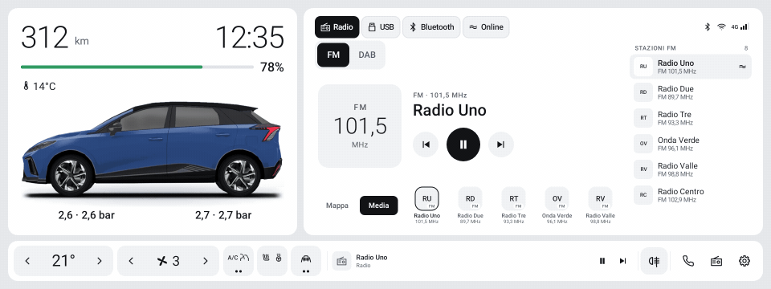</p>

<p align="center">
<b>Launcher in stile Tesla per l'infotainment MG4 SWI133</b><br>
<i>Tesla-style launcher for the MG4 SWI133 infotainment</i>
</p>

<p align="center">
<a href="releases/MG4Launcher-SWI133-0.3.4.apk"></a>
<a href="https://paypal.me/ErnestoMicco?locale.x=it_IT&country.x=IT"></a> 
</p>

<p align="center">
🇮🇹 <a href="#italiano">Italiano</a> · 🇬🇧 <a href="#english">English</a> ·
<a href="#quale-versione-installare--which-version-should-i-install">Quale versione? / Which version?</a> ·
<a href="#versioni">Novità</a> / <a href="#changelog">What's new</a>
</p>

> ⚠️ **Compatibilità / Compatibility:** solo infotainment **SWI133 (nuova MG4 Luxury)** · only **SWI133 (new MG4 Luxury)** infotainment.
> Per gli altri software usa la versione dedicata · for the other software use the dedicated version:
> **SWI68 SAIC 1.0+** → [Mg4-Launcher-SWI68](https://github.com/ernestomicco2026-cell/Mg4-Launcher-SWI68) · **SWI69 Color Radio** → [Mg4-Launcher-SWI69](https://github.com/ernestomicco2026-cell/Mg4-Launcher-SWI69) ·
> **SWI132 (MG4 MY24)** → [Mg4-Launcher-SWI132](https://github.com/ernestomicco2026-cell/Mg4-Launcher-SWI132).

> 🧪 **Versione sperimentale: ho bisogno di voi.** Non ho un'auto con il software SWI133, quindi questa versione non
> l'ho mai potuta provare in auto: l'ho costruita leggendo il firmware `SWI133-29176-1300R36`, partendo dal launcher
> SWI68 0.8.1. **Solo voi che avete questo software potete aiutarmi a migliorarlo.** Se la installate, lasciate attivo
> **Invio log** (è già acceso) oppure mandatemi il log diagnostico (**Salva log** nelle impostazioni) e
> segnalatemi cosa funziona e cosa no.
>
> 🧪 **Experimental version: I need your help.** I don't have a car with SWI133 software, so I have never been able to
> test this version in a car: I built it by reading the `SWI133-29176-1300R36` firmware, starting from the SWI68
> 0.8.1 launcher. **Only those of you who have this software can help me improve it.** If you install it, keep
> **Log upload** on (it is on by default) or send me the diagnostic log (**Save log** in the settings), and tell me
> what works and what doesn't.

---

## Schermate / Screenshots

<table>
<tr>
<td width="50%" valign="top">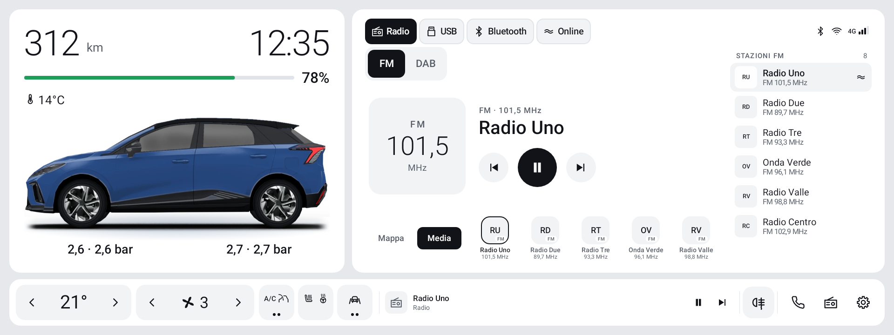<br>
<sub>Tema <b>giorno</b> con la radio: <b>FM/DAB</b> sotto Radio, <b>Mappa/Media</b> in basso prima dei preferiti · <i><b>Day</b> theme with the radio: <b>FM/DAB</b> under Radio, <b>Map/Media</b> at the bottom before the favourites</i></sub></td>
<td width="50%" valign="top"><br>
<sub><b>Animazione di ricarica</b>: l'auto si gira, il cavo si aggancia e la carica scorre; potenza e tempo restante accanto alla temperatura · <i><b>Charging animation</b>: the car turns, the cable plugs in and the charge flows; power and time left next to the temperature</i></sub></td>
</tr>
<tr>
<td width="50%" valign="top">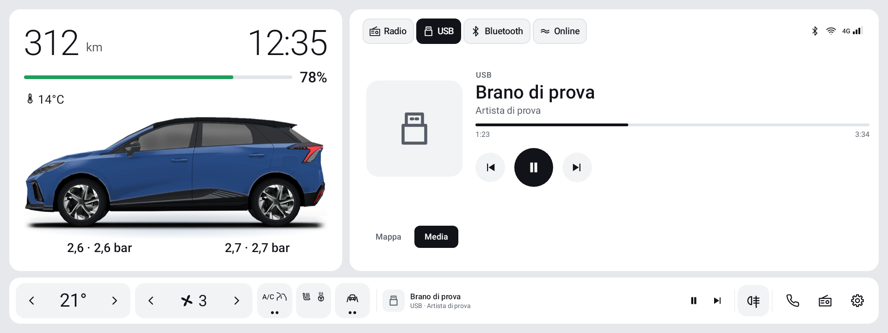<br>
<sub>Sorgente <b>USB</b>: pulsanti delle sorgenti più grandi, ognuno con il suo fondo · <i><b>USB</b> source: bigger source buttons, each with its own background</i></sub></td>
<td width="50%" valign="top">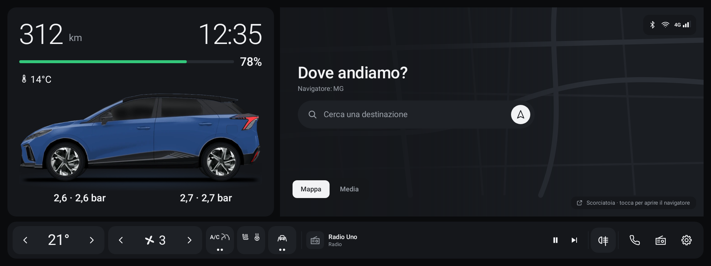<br>
<sub>Riquadro <b>Mappa</b> di notte, con Mappa/Media in basso a sinistra · <i><b>Map</b> panel at night, with Map/Media at the bottom left</i></sub></td>
</tr>
<tr>
<td width="50%" valign="top">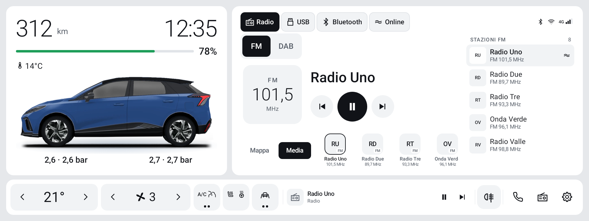<br>
<sub>Dimensione comandi <b>Grande</b>: testo e pulsanti crescono insieme · <i>Control size <b>Large</b>: text and buttons grow together</i></sub></td>
<td width="50%" valign="top">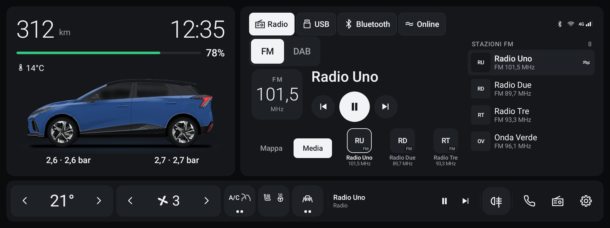<br>
<sub>Dimensione comandi <b>Molto grande</b>, di notte: tutte le sorgenti con la scritta · <i>Control size <b>Extra large</b>, at night: every source keeps its label</i></sub></td>
</tr>
<tr>
<td width="50%" valign="top">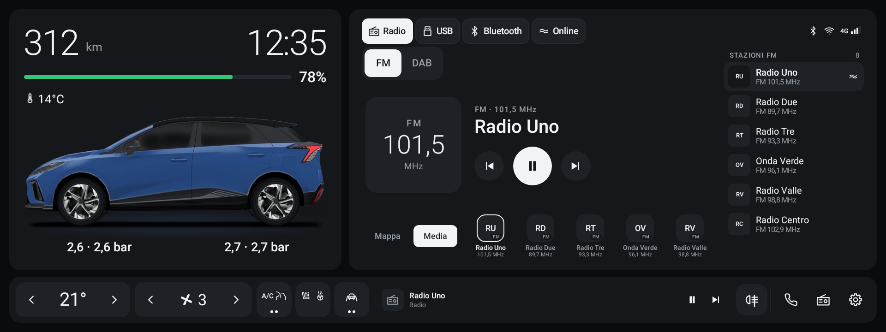<br>
<sub>Tema <b>notte</b> con la radio, dimensione Normale · <i><b>Night</b> theme with the radio, Normal size</i></sub></td>
<td width="50%" valign="top">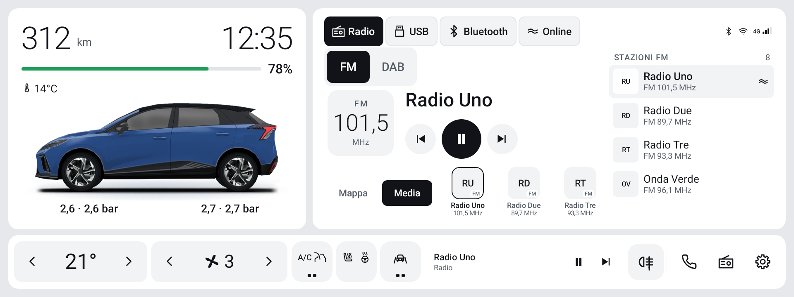<br>
<sub>Dimensione comandi <b>Molto grande</b>, di giorno · <i>Control size <b>Extra large</b>, by day</i></sub></td>
</tr>
</table>

<table>
<tr>
<td width="50%" valign="top">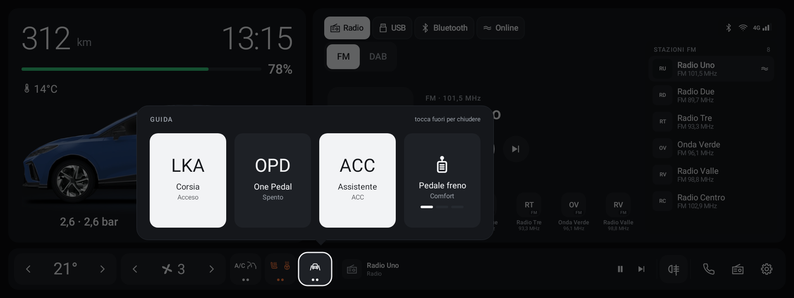<br>
<sub>Gruppo <b>Guida</b> aperto dalla barra: corsia, One Pedal, assistente, pedale del freno · <i><b>Driving</b> group opened from the bar: lane, One Pedal, assistant, brake pedal</i></sub></td>
<td width="50%" valign="top">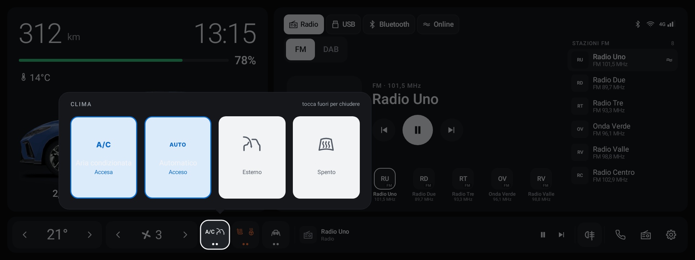<br>
<sub>Gruppo <b>Clima</b>: A/C, automatico, ricircolo · <i><b>Climate</b> group: A/C, auto, recirculation</i></sub></td>
</tr>
<tr>
<td width="50%" valign="top">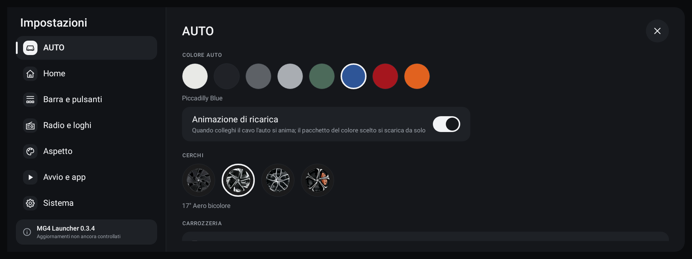<br>
<sub><b>Impostazioni → Auto</b>: colore, animazione di ricarica, cerchi e tetto · <i><b>Settings → Car</b>: colour, charging animation, wheels and roof</i></sub></td>
<td width="50%" valign="top">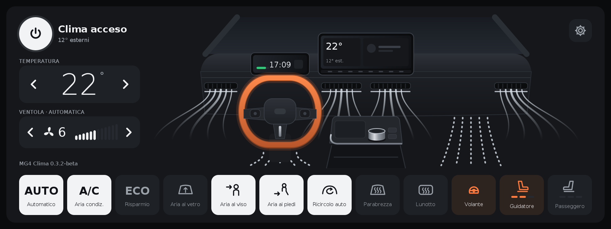<br>
<sub><a href="https://github.com/ernestomicco2026-cell/HVAC-Clima-MG4">MG4 Clima</a> aperto dal tasto del clima · <i><a href="https://github.com/ernestomicco2026-cell/HVAC-Clima-MG4">MG4 Clima</a> opened from the climate button</i></sub></td>
</tr>
</table>

<table>
<tr>
<td width="50%" valign="top">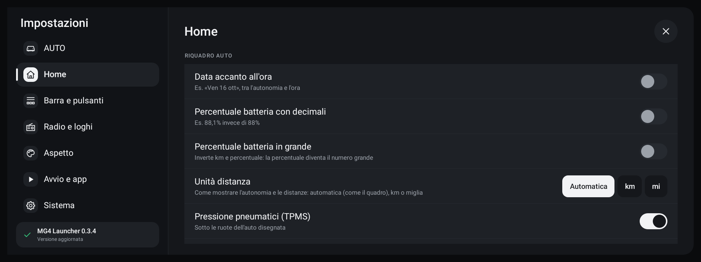<br>
<sub><b>Impostazioni → Home</b>: le 7 sezioni nel menu, con il riquadro aggiornamenti sempre in basso · <i><b>Settings → Home</b>: the 7 sections in the menu, with the updates box always at the bottom</i></sub></td>
<td width="50%" valign="top">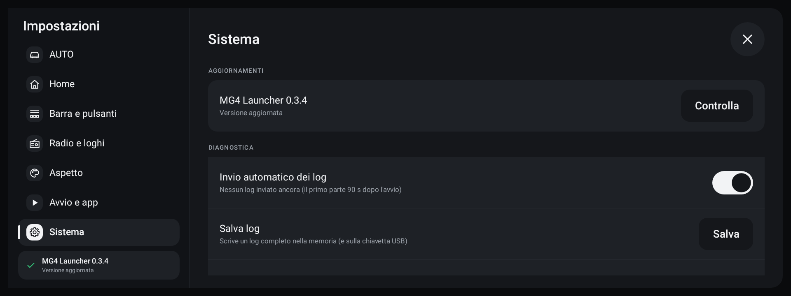<br>
<sub><b>Impostazioni → Sistema</b>, comandi molto grandi: aggiornamenti, log, Controllo funzioni, Disinstalla · <i><b>Settings → System</b>, extra-large controls: updates, logs, Feature check, Uninstall</i></sub></td>
</tr>
<tr>
<td width="50%" valign="top">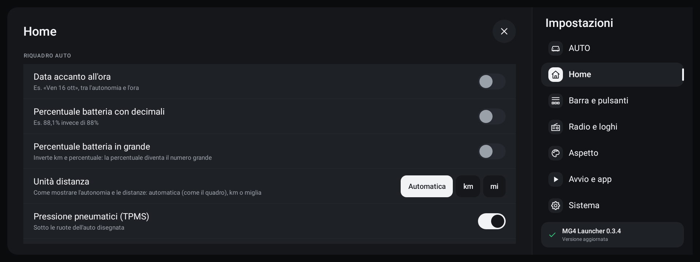<br>
<sub><b>Impostazioni</b>, guida a destra: menu a destra, spazio per la spia luci di sistema · <i><b>Settings</b>, right-hand drive: menu on the right, room for the system light indicator</i></sub></td>
<td></td>
</tr>
</table>

<sub>Simulazioni della grafica: valori, stazioni e loghi sono di esempio · Design mock-ups: values, stations and logos are examples.</sub>

> 🌡️ **Nuovo: [MG4 Clima](https://github.com/ernestomicco2026-cell/HVAC-Clima-MG4)** — la schermata del clima in stile Tesla, per SWI68, SWI69, SWI132 e SWI133. Con MG4 Clima installato il tasto del clima del launcher apre direttamente quella.
>
> 🌡️ **New: [MG4 Clima](https://github.com/ernestomicco2026-cell/HVAC-Clima-MG4)** — the Tesla-style climate screen, for SWI68, SWI69, SWI132 and SWI133. With MG4 Clima installed the launcher's climate button opens it directly.

---

## Quale versione installare? / Which version should I install?

Ci sono **quattro launcher diversi**, uno per ciascun software dell'infotainment MG4. Non sono intercambiabili:
servizi dell'auto, radio, media e clima sono diversi. Se installi la versione sbagliata, il launcher lo riconosce,
mostra un avviso con il link alla versione giusta e non tenta nessun collegamento all'auto.

| Software dell'auto | Auto | Repository | File APK |
|---|---|---|---|
| **SWI68 SAIC 1.0+** | MG4 | [Mg4-Launcher-SWI68](https://github.com/ernestomicco2026-cell/Mg4-Launcher-SWI68) | `MG4Launcher-X.Y.Z.apk` |
| **SWI69 Color Radio** | MG4 MY23 | [Mg4-Launcher-SWI69](https://github.com/ernestomicco2026-cell/Mg4-Launcher-SWI69) | `MG4Launcher-SWI69-X.Y.Z.apk` |
| **SWI132** | MG4 MY24 | [Mg4-Launcher-SWI132](https://github.com/ernestomicco2026-cell/Mg4-Launcher-SWI132) | `MG4Launcher-SWI132-X.Y.Z.apk` |
| **SWI133** | MG4 Luxury MY24 | **questo repository** | `MG4Launcher-SWI133-X.Y.Z.apk` |

**Come sapere quale software hai:** con il computer collegato all'auto
`adb shell getprop ro.build.mt2712.version` → l'inizio dice il software: `SWI68-…`, `SWI69-…`, `SWI132-…` o `SWI133-…`.
Se il launcher è già installato: impostazioni → riga **MG4 Launcher X.Y.Z · repository** sotto *Aggiornamenti*;
il nome del repository dice quale versione hai.

There are **four different launchers**, one per MG4 infotainment software, and they are not interchangeable. If you
install the wrong one, the launcher recognises it, shows a notice with a link to the right version and does not try to
connect to the car. Check your software with `adb shell getprop ro.build.mt2712.version` (it starts with `SWI68-`, `SWI69-`, `SWI132-` or
`SWI133-`) and use the matching repository above.

---

## Video recensione / Video review

<a href="https://youtu.be/JKZ0N3Lr7FI"></a>

Guarda la [video recensione su YouTube](https://youtu.be/JKZ0N3Lr7FI) · Watch the [video review on YouTube](https://youtu.be/JKZ0N3Lr7FI).

---

## Italiano

Launcher in stile Tesla per l'infotainment della **nuova MG4 Luxury** con software **SWI133** (MY24, Android Automotive 9).
È la stessa home della versione SWI68 1.0.4 (grafica, opzioni, testi e lingue identici), adattata ai servizi di questo software.

**Compatibilità:** funziona **solo con il software SWI133**. Con altri software dell'infotainment i servizi dell'auto
sono diversi: il launcher se ne accorge, mostra un avviso con il link alla versione giusta e non si collega all'auto.
**Versione sperimentale:** non l'ho potuta provare in auto; è costruita sul firmware `SWI133-29176-1300R36`. Per
aiutarmi lascia attivo l'invio dei log o mandami il log diagnostico (vedi *Segnalare un problema*).
Per gli altri software ci sono launcher dedicati: **SWI68 SAIC 1.0+** → [Mg4-Launcher-SWI68](https://github.com/ernestomicco2026-cell/Mg4-Launcher-SWI68), **SWI69 Color Radio** → [Mg4-Launcher-SWI69](https://github.com/ernestomicco2026-cell/Mg4-Launcher-SWI69), **SWI132** (MG4 MY24) → [Mg4-Launcher-SWI132](https://github.com/ernestomicco2026-cell/Mg4-Launcher-SWI132).
Sostituisce la schermata home originale mantenendone le funzioni, con una grafica nuova e pulita.

**Indice:** [Cosa fa](#cosa-fa) · [Installazione](#installazione) · [Aggiornamenti](#aggiornamenti) · [Tornare alla home MG originale](#tornare-alla-home-mg-originale) · [Comandi utili](#comandi-utili) · [Segnalare un problema](#segnalare-un-problema) · [Sostieni il progetto](#sostieni-il-progetto) · [Versioni](#versioni)

### Cosa fa

- **Auto e batteria** (a sinistra): autonomia e **orologio** in grande, barra della batteria con percentuale e tacca del
  limite di ricarica, **data** (facoltativa), stato solo durante la ricarica o il V2L (tipo, potenza, tempo rimanente),
  temperatura esterna (e interna, se l'auto la fornisce); sotto l'auto la **pressione degli pneumatici** (TPMS, in bar,
  kPa o psi) e, se li attivi, i **pulsanti di ricarica** (limite, corrente AC, avvia/ferma ricarica o V2L, con conferma).
  - **L'auto è disegnata dal modello 3D**, negli 8 colori della gamma, con i cerchi a scelta (Aero 17", Nero 16",
    Luxury 18", XPower 18"), il tetto nero se vuoi e **i fari accesi quando sono accesi davvero**.
  - **Animazione di ricarica**: quando colleghi il cavo l'auto si gira, il cavo si aggancia e la carica scorre; a carica
    finita resta ferma, quando stacchi il cavo si sgancia. Il pacchetto del colore scelto si scarica da solo una volta
    (e si riscarica da solo quando viene aggiornato); si può spegnere.
  - Tocca l'auto → gestione della ricarica. Tienila premuta → impostazioni del launcher.
- **Mappa / Media** (a destra), con i pulsanti **Mappa** e **Media** in basso a sinistra:
  - **Mappa**: indicazioni del navigatore (prossima manovra, via, arrivo). Senza guida: **Dove andiamo?** con la barra
    *Cerca una destinazione*, i riquadri **Casa** e **Lavoro** e la riga **Apri con**. Il navigatore predefinito si
    sceglie nelle impostazioni: navigatore MG, CarPlay/Android Auto o un'altra app (Google Maps, Waze, ABRP...).
  - **Media**: in alto i pulsanti delle sorgenti (Radio, USB, Bluetooth, Online: scegli tu quali mostrare). Per la
    radio: **FM / DAB** sotto Radio, logo e frequenza della stazione, comandi grandi, **elenco delle stazioni trovate**
    a destra (tocca per sintonizzare) e, in basso, i **preferiti** con logo, nome e frequenza. I **pacchetti dei loghi
    per paese** si scaricano una volta e poi funzionano senza internet; si installano anche da chiavetta
    (`MG4Launcher/loghi/IT.zip`) e puoi aggiungere i tuoi nella cartella **MG4Launcher/loghi**.
  - All'accensione riparte la sorgente che stavi ascoltando: la radio aspetta che il sintonizzatore sia pronto, il
    Bluetooth che il telefono sia collegato.
- **Barra in basso**: clima con pulsanti grandi da usare in guida: temperatura ‹ › (17 = LO … 33 = HI), ventola ‹ ›
  (OFF / 1…11 / A = automatico; tocca l'icona = **pannello clima di sistema**, o [MG4 Clima](https://github.com/ernestomicco2026-cell/HVAC-Clima-MG4)
  se installato; tieni premuto = accendi/spegni), i gruppi **Clima** (A/C, AUTO, ricircolo), **Comfort** (sedili e
  volante riscaldati, solo quelli che l'auto ha) e **Guida** (LKA, One Pedal, assistente Spento/ACC/TJA, pedale del
  freno): un tocco apre sopra la barra le caselle grandi. Poi il **riquadro accanto al clima** (la musica, fino a 6
  preferiti del telefono da chiamare con un tocco o fino a 6 app), **retronebbia** (si può nascondere; sulla SWI133 i
  fendinebbia anteriori non sono comandabili), **CarPlay / Android Auto** con la loro icona originale quando il
  telefono è collegato, Telefono, Radio, **360°** e Impostazioni.
- **In alto a destra**: indicatori di **Bluetooth**, **Wi-Fi** e rete **4G** della T-Box (con le tacche del segnale).
- **App**: scorri la home verso sinistra per le app dell'auto e quelle che installi tu, con le icone tutte nello stesso
  stile. Con **Modifica** scegli quali app mostrare; con la **pressione lunga** su un'app installata da te la puoi
  **disinstallare** (le app di sistema e quelle MG sono protette). **MG4 Store** è già dentro il launcher: alla prima
  accensione si installa da solo e poi si aggiorna per conto suo.
- **Tema giorno/notte di tutto il sistema**: lo decide il launcher (scelta manuale, fari, alba e tramonto) e lo applica
  anche al pannello clima, alle app MG e alla tendina.
- **Dopo la retromarcia** torna l'app che avevi davanti (CarPlay, Android Auto, navigatore...), senza riavviarla.
- **Impostazioni** (tieni premuta l'auto, o l'ingranaggio): a schermo intero, con un menu di sette sezioni e la
  versione con lo stato degli aggiornamenti sempre visibile in basso. Cambiando un'opzione la pagina resta dov'era.
  - **Auto**: colore, animazione di ricarica, cerchi, tetto nero, posizione di guida (con la guida a destra la home si
    specchia);
  - **Home**: data, percentuale della batteria, unità di distanza, pressione degli pneumatici, temperatura interna,
    limite di ricarica, navigatore predefinito, **sorgenti audio**, pulsante accanto a Mappa/Media;
  - **Barra e pulsanti**: barra grande, pulsanti raggruppati, LKA e OPD, retronebbia, pulsanti di ricarica, riquadro
    accanto al clima, tasto 360;
  - **Radio e loghi**: paese e pacchetti dei loghi, cartella dei loghi personali;
  - **Aspetto**: tema (automatico, notte, giorno), **dimensione delle app e dei comandi** (Normale, Grande, Molto
    grande), **lingua**;
  - **Avvio e app**: home predefinita, modalità officina, **Premi Home da solo dopo l'accensione**, home originale MG,
    ritorno dopo la retromarcia;
  - **Sistema**: aggiornamenti, invio automatico dei log, **Salva log**, diagnostica dei servizi, Installa MG4 Store,
    **Prova animazione di ricarica**, **Controllo funzioni** (prova in sola lettura cosa funziona su questa auto) e
    **Disinstalla** (rimette la home MG originale e solo dopo toglie il launcher).
- **Schermo intero**: barra di stato e dock MG nascosti (trascina dal bordo per richiamarli).
- **Aggiornamenti**: le nuove versioni si scaricano e si installano dalle impostazioni, senza computer; se all'accensione
  la rete non c'è ancora, il controllo riparte appena arriva.
- **Lingue**: italiano, inglese, spagnolo, tedesco, portoghese, francese, turco e polacco. Con **Automatica**
  (predefinita) il launcher segue la lingua di sistema dell'auto; altrimenti scegli la lingua nelle impostazioni. Con
  una lingua di sistema non tradotta usa l'inglese.

### Installazione

Solo per infotainment **SWI133**. Scarica l'APK dalla cartella [`releases/`](releases/).
Si installa come una normale app: non serve per forza un computer. Ci sono due modi: da chiavetta USB, con il file manager dell'auto, oppure con adb da computer.

#### Metodo 1 — Da chiavetta USB (senza computer)

1. Copia `MG4Launcher-SWI133-0.3.4.apk` su una chiavetta USB formattata **FAT32** o **exFAT**.
2. Inserisci la chiavetta nell'auto, apri il file manager e tocca l'APK.
3. Se Android avvisa che non può installare app da questa fonte: tocca **Impostazioni**, attiva
   **Consenti da questa fonte** per il file manager e torna indietro.
4. Tocca **Installa**.
5. Premi il tasto **Home**: Android chiede quale home usare. Scegli **MG4 Launcher** e poi **Sempre**.

Se l'installazione dà errore, usa il metodo 2 (e, se puoi, segnala il messaggio d'errore).

#### Metodo 2 — Con adb da computer

Serve un computer con [adb](https://developer.android.com/tools/releases/platform-tools) collegato all'auto.
Il firmware MG può bloccare l'installazione normale delle app: l'opzione `-f` la permette.

1. Installa:
   ```bash
   adb install -r -f MG4Launcher-SWI133-0.3.4.apk
   ```
2. Rendilo la home predefinita:
   ```bash
   adb shell cmd package set-home-activity com.mg4.launcher/.MainActivity
   ```
   In alternativa premi il tasto Home: Android chiede quale home usare.

All'accensione il firmware apre comunque la home MG originale: il launcher se ne accorge e torna in primo piano da solo,
grazie a un servizio di accessibilità che guarda solo quale app è in primo piano,
senza toccare la retrocamera, CarPlay/Android Auto o una chiamata. A ogni avvio riconferma anche di essere la home predefinita.

**Home MG originale e modalità officina** (Impostazioni → Sistema):
- *Usa come home predefinita* spento: la home MG torna quella predefinita, anche all'accensione; il launcher resta
  usabile come app. *Modalità officina* (1, 3 o 7 giorni): per l'assistenza l'auto usa la home MG e gli aggiornamenti
  sono sospesi; alla scadenza il launcher torna da solo, come prima.
- Per rientrare prima: la home MG non mostra MG4 Launcher tra le sue app (ha un elenco fisso), quindi serve un computer:
  `adb shell cmd package set-home-activity com.mg4.launcher/.MainActivity`, poi riaccendi l'interruttore nelle impostazioni.

### Aggiornamenti

Impostazioni del launcher → **Aggiornamenti** → **Controlla aggiornamenti**.
Se c'è una versione più nuova compare **Scarica e installa**: il launcher la installa da solo e si riavvia.
Gli aggiornamenti si possono installare anche da computer, con lo stesso comando dell'installazione.

Il launcher **controlla da solo** se c'è una versione nuova (2 minuti dopo l'accensione e poi ogni 6 ore) e la segnala
con un avviso discreto con il pulsante **Aggiorna**. Può anche mostrare **avvisi importanti** sul launcher (per esempio
un aggiornamento da fare). Se una versione ha un problema serio, l'aggiornamento si può rendere obbligatorio: il
launcher lo installa da solo, solo **ad auto ferma** e mai durante la guida.

### Tornare alla home MG originale

Dal launcher: impostazioni → **Apri la home originale MG**. Per renderla di nuovo quella predefinita:

```bash
adb shell cmd package set-home-activity com.saicmotor.hmi.launcher/.ui.MainActivity
```

Per rimuovere del tutto il launcher, anche senza computer (dalla 0.2.1): impostazioni → **Disinstalla MG4 Launcher**.
Rimette la home MG originale, controlla che sia davvero accesa e solo dopo toglie il launcher dall'auto. Non usare il
menu App di Android: se l'auto resta su "Smartphone starting", installa [MG4 Ripristino Home](https://github.com/ernestomicco2026-cell/Mg4-Launcher-SWI68/raw/main/releases/MG4HomeRescue-1.0.apk) da chiavetta e aprilo.
Da computer: `adb uninstall com.mg4.launcher`.
L'app originale non viene mai modificata.

### Comandi utili

```bash
# riavviare il launcher senza spegnere l'auto
adb shell am force-stop com.mg4.launcher
adb shell am start -n com.mg4.launcher/.MainActivity

# vedere i valori letti dall'auto (Ctrl+C per fermare)
adb logcat -s MG4L MG4L.Link

# scaricare la diagnostica salvata dal launcher (aggiornata ogni 15 s)
adb pull /sdcard/Android/data/com.mg4.launcher/files/diagnostica.txt
```

### Segnalare un problema

In Impostazioni → Sistema, **Diagnostica servizi** fa vedere i valori grezzi letti da ogni servizio
(veicolo, clima, media, radio, CarPlay, navigatore) e gli errori recenti. Uno screenshot di quella pagina
o il file `diagnostica.txt` bastano per capire cosa succede.

I log diagnostici vengono inviati automaticamente in forma anonima, per migliorare il launcher; l'invio si può
disattivare in Impostazioni → Sistema.

Con **Salva log** (in Impostazioni → Sistema) il launcher scrive un log completo — valori, errori, eventi
recenti e logcat del launcher — in `Android/data/com.mg4.launcher/files/mg4-launcher-log-….txt`.
Se è inserita una chiavetta USB il file finisce anche lì, nella stessa cartella: basta aprirla dal computer o dal telefono.

### Sostieni il progetto

MG4 Launcher è e resterà **gratuito**. Se ti è utile e ti va di contribuire alle ore passate a svilupparlo e provarlo
in auto, puoi lasciare un'offerta: è del tutto **volontaria** e **non c'è un importo minimo**, puoi donare quello che
vuoi. Anche una stella al repository o una segnalazione di un problema sono un aiuto prezioso. Grazie!

Anche solo **2 €** sono un aiuto prezioso per continuare a sviluppare e provare in auto le nuove versioni.

[](https://paypal.me/ErnestoMicco?locale.x=it_IT&country.x=IT)

### Versioni

#### 0.3.4
- **Disinstallazione sicura**: "Disinstalla" riaccende la home originale MG, controlla che sia davvero attiva e solo
  dopo toglie il launcher; mentre la conferma è a schermo il launcher non la rispegne più. Anche aprendo le impostazioni
  di Android la home MG si riaccende in anticipo. Per chi è già rimasto su "Smartphone starting" c'è la piccola app
  **MG4 Ripristino Home** ([MG4HomeRescue-1.0.apk](https://github.com/ernestomicco2026-cell/Mg4-Launcher-SWI68/raw/main/releases/MG4HomeRescue-1.0.apk)), valida per tutti i software, che riaccende la home originale.
- **Tema giorno/notte di tutto il sistema**: ora lo decide il launcher (scelta manuale, fari, alba/tramonto) e lo
  scrive nel sistema: il pannello clima, MG4 Control, le app MG e la tendina seguono da soli.
- **Fari letti dall'auto** (luci di posizione e anabbaglianti): fari accesi sull'auto disegnata e tema più preciso.
  Prima le luci di posizione accese non venivano riconosciute.
- **Nuova home**: Mappa/Media in basso, prima dei preferiti; FM/DAB di nuovo sotto Radio; pulsanti delle sorgenti più
  grandi, ognuno con il suo fondo. CarPlay e Android Auto solo nella barra in basso, con la loro icona originale.
- **Elenco delle stazioni** più leggibile, più in alto (accanto a FM/DAB) e a destra; solo righe intere.
- **Auto disegnata dal modello 3D**: la stessa auto dell'animazione di ricarica, nella stessa posa e con gli stessi
  colori, così il passaggio all'animazione non si nota. Restano colori, cerchi, tetto nero e fari accesi.
- **Impostazioni**: cambiando un'opzione la pagina resta dov'era, invece di tornare in cima, anche dopo una pausa.
- **Disinstallare le app**: pressione lunga sull'icona di un'app installata da te → "Disinstalla", con conferma. Le app
  di sistema, quelle MG e le nostre app sono protette.
- **Dimensione "Molto grande"** sistemata: tutte le sorgenti con la scritta, tasti della radio interi, testo della barra
  in basso non più troncato; testo, pulsanti, preferiti ed elenco crescono con la dimensione scelta.
- **Animazione di ricarica**: quando colleghi il cavo l'auto si anima (aggancio, in carica, carica finita, sgancio).
  Il pacchetto del colore scelto si scarica da solo, e si riscarica da solo quando viene aggiornato; si può
  disattivare nelle impostazioni.
- **MG4 Store incluso**: alla prima accensione si installa da solo se manca, poi si aggiorna per conto suo.
- **Sorgenti audio a scelta** e **app di navigazione a scelta** (anche Google Maps, Waze, ABRP...).
- **Radio all'accensione** più affidabile: aspetta che il sintonizzatore sia pronto (fino a circa un minuto).
- **Ritorno dopo la retromarcia**: riporta davanti la finestra già aperta, senza riavviare le app.
- Controllo funzioni con le prove "tema di sistema", "fari" e "animazione di ricarica"; log della patch Radio Fix.
- L'opzione "Ordine in alto" della 0.3.3 non serve più ed è stata tolta.

#### 0.3.3
- **Tema giorno/notte**: sulle auto dove il sistema resta sempre su "notte" il launcher se ne accorge (uiMode che non
  cambia da 12 ore di accensione e contraddice il sole) e segue i fari e l'alba/tramonto. Niente più tema notte in
  pieno giorno. La scelta manuale Giorno/Notte ha sempre la precedenza.
- **FM/DAB** di nuovo accanto ai comandi della radio, come prima, e più grande.
- **Ordine dei comandi in alto** nel riquadro destro, nuova opzione in Impostazioni → Home: "Sorgenti, poi Mappa/Media"
  (come prima) oppure "Mappa/Media, poi Sorgenti", comodo per chi usa lo schermo con la mano destra.
- **Riquadro accanto al clima** configurabile (Barra e pulsanti): Media come prima, fino a 6 preferiti del telefono da
  chiamare con un tocco, oppure fino a 6 scorciatoie alle app.
- **Radio**: l'elenco delle stazioni si aggiorna da solo dopo una ricerca e tornando dall'app Radio; se è vuoto si
  vedono i preferiti.
- **Bluetooth all'accensione**: la musica riparte solo quando il telefono è collegato davvero (fino a 30 s di attesa);
  titolo e artista arrivano prima dal telefono, poi dal sistema.
- **Temperatura interna**: Automatico / Mostra / Nascondi; se l'auto non la fornisce l'opzione sparisce da sola.
- **Aggiornamenti**: se all'accensione la rete non c'è ancora, il controllo riparte appena arriva (o dopo 2 minuti),
  non più dopo 6 ore.
- **Controllo funzioni** in Impostazioni → Sistema: prova in sola lettura cosa funziona su questa auto (servizi,
  temperature, tema, USB, Bluetooth, stazioni, tasti al volante, pannello clima, aggiornamenti, log) e permette di
  inviare il log.
- Corretto un arresto all'apertura di un'app senza nome di attività; se l'app scelta per un pulsante non c'è più torna
  il pulsante predefinito.

#### 0.3.2
- **Dopo la retromarcia** il launcher riapre l'app che avevi davanti: CarPlay, Android Auto (anche da box o dongle),
  il navigatore o un'altra app. Non lo fa se nel frattempo premi Home o scegli un'altra app, se la telecamera resta
  aperta più di 5 minuti o se il telefono/box non è più collegato. Si può spegnere (Avvio e app).
- **Tema giorno/notte** più robusto: segue il sistema e, quando serve, i fari dell'auto o alba e tramonto; prima di
  cambiare aspetta un minuto. La scelta manuale ha sempre la precedenza.
- **Card media**: la scelta FM/DAB sta sotto il pulsante Radio, collegata a lui, e compare solo con la Radio; i
  comandi hanno più spazio. Con «Nessuno» come pulsante in alto a destra le sorgenti hanno sempre la scritta.
- **Audio all'accensione**: riprende l'ultima sorgente usata davvero (Bluetooth, radio, USB, CarPlay/Android Auto);
  la radio parte davvero (anche col tasto Play) e il Bluetooth riprova prima di aprire l'app Musica. Copertina del
  brano Bluetooth quando il telefono la manda.
- **Radio non pronta** all'accensione: nuovi tentativi automatici, senza errori.
- **Temperatura interna** di nuovo attivabile: solo da una fonte valida, altrimenti «--» (mai l'esterna).
- Temperatura esterna più compatta, **fari accesi** sul disegno dell'auto, pressione gomme più grande, animazione
  più fluida verso la schermata App, icone **360°** con la scritta (Video USB con l'icona della pellicola).
- **Limite di ricarica**: in automatico solo se l'auto supporta il comando (Automatico / Mostra / Nascondi).
  **Ricarica programmata** tra i pulsanti di ricarica, solo se l'auto la supporta.
- **Pulsante in alto a destra** a scelta: CarPlay/Android Auto, un'app o nessuno.
- **Aggiornamenti automatici** e avvisi importanti da remoto.

#### 0.3.1
- Il menu delle impostazioni scorre di nuovo e la sezione aggiornamenti è sempre raggiungibile

#### 0.3.0
- **Tasto Home touch dello schermo**: corretto, ora torna sempre al launcher.
- **Tasto Home fisico**: chiude le finestre aperte (impostazioni, app) invece di lasciarle sopra la home.
- **Unità distanza** configurabile (automatica, km o miglia) per l'autonomia e le distanze del navigatore.
- **Icone del clima**: barra in basso e riquadri Clima/Comfort usano ora le icone ufficiali di MG4 Clima (A/C, AUTO,
  ricircolo, sedili e volante riscaldati), con colore e sfondo evidenziati secondo lo stato (acceso, caldo, spento,
  non disponibile), giorno e notte. Aggiunto il riquadro **Sbrinamento parabrezza** nel gruppo Clima.
- **CarPlay / Android Auto**: tutta la scheda si tocca per aprire, non solo il pulsante.
- **Sblocca presa di ricarica**: nuovo pulsante sempre visibile nella barra di ricarica, con conferma prima
  dell'invio; spiega da solo se lo stato della presa non è ancora noto.
- **Impostazioni riorganizzate** (sezioni Barra e pulsanti, Radio e loghi, Avvio e app), **tasto 360** che si può
  scegliere cosa apre, **cartella loghi personali** da USB e **navigatore predefinito** per il riquadro mappa.
- **Paese dei loghi radio automatico**: ordine più affidabile (RDS/DAB → lingua e regione d'accordo → fuso → regione).
- **Rete senza internet**: invio dei log, controllo aggiornamenti e loghi condividono ora una sola pausa crescente.

#### 0.2.8
- **Riavvio del dongle CarPlay/AA**: non resetta più i telefoni collegati col cavo (iPhone, Android Auto). Interviene
  solo sui dongle wireless riconosciuti dal nome (es. smartlinkBox, OKBox, AAWireless, SmartBox, AutoKit) o già visti
  in una sessione con il nome del dongle; i dongle CarPlay che si presentano come iPhone vengono riconosciuti dopo la
  prima sessione. Con un telefono collegato la porta USB non si tocca. Nel log c'è il motivo di ogni esclusione.
- **Velocità**: il launcher si concede il permesso della velocità; se l'auto non lo concede non la rilegge più e lo
  scrive una sola volta nel log.
- **Certificati**: aggiunte le radici USERTrust ECC e Sectigo R46/E46 (oltre a USERTrust RSA) per loghi, aggiornamenti
  e invio dei log; nel log c'è la causa precisa degli errori di connessione.
- **Prima configurazione di Android**: se la home risulta la procedura di prima configurazione, il launcher la
  riconosce, scrive nel log lo stato della configurazione e non la tratta come la home MG.
- **Log**: nessun invio da telefoni, emulatori o firmware non riconosciuti.

#### 0.2.7
- **Schermata App**: dimensione separata per icone e testo (più grandi), da scegliere nelle impostazioni.
- **Dongle**: il log registra se il dongle ricompare dopo il reset.
- **Certificati**: aggiunta la radice di sicurezza USERTrust RSA (Sectigo) per le connessioni a GitHub.

#### 0.2.6
- **Avvio sicuro**: il launcher diventa la home del sistema e parte sempre all'accensione e col tasto Home. Si disattiva
  solo la schermata principale della home MG (il resto dell'app MG resta attivo), che torna da sola con l'officina,
  l'interruttore spento, "Disinstalla", l'apertura apposta della home MG o se il launcher si chiude 3 volte in 3
  minuti. Si spegne in Impostazioni › Sistema.
- **Avvio più affidabile**: la home MG aperta apposta non blocca più l'accensione successiva; se la home MG non
  compare il launcher si apre lo stesso; se un'altra app gli toglie l'accessibilità se la rimette; avviso se è
  installato un altro launcher.
- **Loghi radio**: Australia e Sud America (pacchetti scaricabili), e il paese si può scrivere a mano (pulsante Codice).
- **Sedili riscaldati nel riquadro Comfort**: 3 → 2 → 1 → spento come i pulsanti singoli (prima "spento" non
  restava); con la guida a destra il guidatore è a destra e ogni casella comanda il sedile che ha davanti.
- **Pannello clima di sistema**: con MG4 Clima aperto si chiude da solo appena compare.
- **CarPlay / Android Auto**: si apre con un solo tocco e ha la sua icona nella barra finché il telefono è collegato.
- **Impostazioni**: tolto lo spazio vuoto tra Riquadro auto e Barra in basso.

<details>
<summary><b>Versioni precedenti</b></summary>

#### 0.2.5
- **Gruppo Guida** nella barra (icona dell'auto tra le linee della corsia): LKA, One Pedal, **assistente di guida**
  (Spento / ACC / TJA) e **sensibilità del pedale del freno** (Comfort / Medium / Sport) in un unico riquadro, solo i
  comandi che l'auto ha. Assistente e pedale si cambiano solo ad auto ferma.
- **Ricircolo a 3 stati** come l'app clima originale: Interno → Esterno → Auto, con l'icona che cambia.
- **Temperatura interna tolta**: l'auto non la manda allo schermo (il valore "ambient" era la temperatura esterna).
  Nelle impostazioni c'è la spiegazione.
- **Pagina App**: con **Modifica** si possono nascondere anche le app dell'auto, non solo quelle installate.

#### 0.2.4
- **Ventola su OFF**: l'auto non accetta la ventola a 0 e dopo un attimo la rimetteva a 1. Come nell'app originale,
  la ventola va da 1 in su e OFF ora spegne davvero il clima.

#### 0.2.3
- **Cerchi a scelta** nelle impostazioni (Auto, sotto il colore): 16″ copricerchi neri, 17″ Aero bicolore (di serie),
  18″ Luxury / Trophy e 18″ XPOWER. Si vedono sull'auto della home e nell'anteprima.
- **Temperatura esterna più affidabile**: il launcher controlla il flag di validità del firmware, come il pannello
  originale, e non mostra più valori non validi come -40°.
- **Temperatura interna nascosta**: l'auto non la fornisce con le proprietà standard. Quella chiamata "ambient" è la
  temperatura esterna, che prima con l'opzione accesa si vedeva come interna. Il launcher ora la cerca tra tutte le
  proprietà dell'auto e scrive nei log i valori trovati, per poterla aggiungere in una prossima versione.
- **Dongle CarPlay / Android Auto**: riconosciuti anche quelli che si presentano come un iPhone o un telefono Android
  (es. SmartBox). Se dopo il ritardo non parte nessuna sessione, il dispositivo viene riavviato.
- **Popup delle novità a ogni versione**, con le novità di quella versione.

#### 0.2.2
- **Tasto del clima**: se è installato [MG4 Clima](https://github.com/ernestomicco2026-cell/HVAC-Clima-MG4) apre
  direttamente quello (la nuova schermata del clima in stile Tesla), senza far vedere per un istante il clima originale.
  Senza MG4 Clima tutto resta come prima.

#### 0.2.1
- **La home si apre da sola all'accensione**: dai log di questa versione la home MG arriva spesso *dopo* il launcher
  (fino a 223 secondi dopo), quando il controllo dell'avvio era già finito. Ora, finché la home MG non è comparsa, il launcher la
  aspetta (al massimo 6 minuti) e poi torna davanti; anche *Premi Home da solo* riprova invece di fare un solo
  tentativo. Retrocamera, CarPlay/Android Auto, chiamate e la home MG aperta apposta restano come prima.
- **Niente più crash all'accensione**: prima dello sblocco del sistema le impostazioni del launcher non sono leggibili;
  ora il launcher aspetta lo sblocco invece di chiudersi a ogni avvio.
- **Percentuale batteria in grande** (Impostazioni → Home): inverte km e percentuale.
- **Temperatura interna/esterna e percentuale della batteria più grandi** e più chiare, leggibili durante la guida.
- **Disinstallazione dall'auto**: Impostazioni → Sistema → *Disinstalla MG4 Launcher*. Rimette la home MG originale
  come predefinita e toglie il launcher, senza computer.

#### 0.2.0
Stesse novità della versione SWI68 0.8.2 e 0.8.3, con i servizi della SWI133, verificati sul firmware
`SWI133-29176-1300R36`.
- **Pulsanti raggruppati** nella barra: **Clima** (A/C, AUTO, ricircolo) e **Comfort** (sedili e volante riscaldati,
  solo quelli che l'auto ha). Un tocco apre sopra la barra un riquadro con le caselle grandi (si chiude toccando fuori o
  da solo dopo pochi secondi); i sedili vanno spento → 1 → 2 → 3 → spento. Pressione lunga: A/C o sedile guida.
  Funzionano anche con la barra grande, che ora ha di nuovo il mini player. Si possono spegnere nelle impostazioni
  (*Pulsanti raggruppati*).
- **LKA** (mantenimento corsia) e **OPD** (One Pedal Drive) nella barra, con lo stato reale dell'auto: solo comando
  manuale, nessun automatismo all'avvio. Compaiono solo se l'auto li ha; si possono nascondere.
- **Pacchetti dei loghi radio per paese**, per FM e DAB: si scaricano una volta da questo repository (con controllo
  dell'integrità) e poi funzionano senza internet; paese automatico (dal **fuso orario** dell'auto, poi dalla lingua del
  launcher, confermato dalle stazioni DAB) o scelta di uno o più paesi, *Aggiorna* ed *Elimina* nelle impostazioni,
  installazione da chiavetta. I nomi DAB con `#` davanti e le varianti di una stazione (es. RTL 102.5) trovano il logo.
- **Nome delle stazioni sempre visibile**: nella lista delle stazioni e nei preferiti ci sono sempre logo, nome e
  frequenza (o DAB+). Solo nella copertina grande il logo resta da solo, con il nome accanto.
- **Riavvio del dongle CarPlay/Android Auto** che non si collega: solo con un dongle wireless riconosciuto (mai con un
  telefono via cavo o una chiavetta), al massimo 2 tentativi per accensione, mai durante una chiamata. Attesa
  regolabile e pulsante *Riavvia CarPlay/AA* nelle impostazioni. Sulla SWI133 viene riavviato anche il servizio di
  proiezione MG, così le app dell'auto restano collegate a CarPlay/Android Auto.
- Launcher più leggero: log senza le righe di sistema ripetitive, tolti testi e icone non più usati, immagini dell'auto
  più leggere (identiche), i loghi non sono più dentro l'app.

#### 0.1.0
- Prima versione per **SWI133** (nuova MG4 Luxury), **sperimentale**: stessa grafica, opzioni, testi e lingue della
  versione SWI68 0.8.1, con i servizi verificati sul firmware `SWI133-29176-1300R36`.
- Ricarica, energia, V2L, clima, sedili e volante riscaldati, retronebbia, media, radio, CarPlay/Android Auto,
  navigatore e pressione pneumatici usano gli stessi comandi della SWI68 (verificati uno per uno sul firmware).
- **Clima**: toccando la ventola si apre il pannello Clima dell'auto (sulla SWI133 non è più un'app a parte).
- **Gestione ricarica e Consumi**: aprono la nuova app di ricarica dell'auto, sulla scheda giusta.
- **Fendinebbia anteriori**: sulla SWI133 non sono comandabili, il pulsante non compare.
- **Manuale** e **musica online** (Amazon Music) puntano alle app di questo software.
- Riconosce il software dell'auto (SWI68, SWI69, SWI132 o SWI133): se è quello sbagliato mostra un avviso con il link
  alla versione giusta e non si collega all'auto.
- Log diagnostici nella cartella SWI133 e aggiornamenti da questo repository.

</details>

<details>
<summary><b>Per sviluppatori: compilare, come comunica con l'auto, note</b></summary>

#### Compilare

Nessun Gradle: `./build.sh` usa aapt2, javac (bytecode 8), D8 e firma v1+v2 con la chiave platform AOSP
(la stessa del sistema dell'auto, build test-keys). L'APK esce in `build/`. La versione è in `version.properties`.

**Testi e traduzioni:** stanno tutti in `tools/i18n.py` (una riga per testo, 7 lingue). Dopo una modifica:
`python3 tools/i18n.py` rigenera `app/res/values*/strings.xml`, poi `./build.sh`.

Prima di compilare metti in `tools/` i due file non inclusi nel repository:
- `android.jar` (API 28) da [Sable/android-platforms](https://github.com/Sable/android-platforms);
- `d8.jar`: è `lib/jadx-1.5.1-all.jar` di [jadx 1.5.1](https://github.com/skylot/jadx/releases/tag/v1.5.1), rinominato.

`keys/platform.p12` è la chiave platform **pubblica** di test AOSP (password `android`).

**Pubblicare una nuova versione:** aumenta `VERSION_CODE` e `VERSION_NAME` in `version.properties`, compila,
copia l'APK in `releases/`, aggiorna `releases/latest.json` (versione, nome del file e dimensione) e le Versioni
qui sopra, poi commit e push. Il launcher controlla `releases/latest.json` e anche le Release di GitHub
(tag `vX.Y.Z` con l'APK allegato) e propone la più recente.
Per la Release di GitHub basta crearla con il tag `vX.Y.Z`: l'automazione `.github/workflows/allega-apk.yml`
allega da sola `releases/MG4Launcher-SWI133-X.Y.Z.apk` (e, se la descrizione è vuota, usa le note di `latest.json`).

#### Come comunica con l'auto

Servizi del software **SWI133** (ricavati dall'analisi del firmware `SWI133-29176-1300R36`; sono gli stessi della SWI68
salvo dove indicato).

| Funzione | Servizio | Note |
|---|---|---|
| Energia, ricarica, V2L | `com.saicmotor.service.vehicle` → hub → `vehiclecharging` | stessi comandi della SWI68 |
| Clima, ventola, temperatura esterna | stesso hub → `aircondition` | temperatura 17–33, ventola 1–11 / auto |
| Pannello Clima | SystemUI `com.android.systemui` (StartActivityService) | come la home MG originale |
| Gestione ricarica e consumi | app `com.saicmotor.hmi.chargesettings` | sulla SWI68 era dentro Impostazioni veicolo |
| Retronebbia | stesso hub → `vehiclesetting` | fendinebbia anteriori non disponibili |
| USB / Bluetooth / Online | `com.saicmotor.service.media` | |
| Radio | `com.saicmotor.service.radio` | FM / AM / DAB, preferiti, logo DAB |
| CarPlay / Android Auto | `com.allgo.rui` + MediaBrowser `com.allgo.remoteui.mediabrowserservice` | metadati e indicazioni |
| Navigatore MG | `com.saicmotor.adapterservice` (GeneralService + notifiche) | |

La mappa del navigatore non può essere mostrata dentro il launcher (è un'altra app):
il pannello Mappa mostra le indicazioni e apre il navigatore a schermo intero.

#### Note

- L'immagine dell'auto deriva da una foto ufficiale MG; marchi e immagini appartengono ai rispettivi proprietari.
- I loghi delle stazioni FM vengono da [radio-browser.info](https://www.radio-browser.info), database pubblico e gratuito.

</details>

---

## English

Tesla-style launcher for the **new MG4 Luxury** infotainment system running **SWI133** software (MY24, Android Automotive 9).
It is the same home as SWI68 version 1.0.4 (same design, options, texts and languages), adapted to this software's services.

**Compatibility:** works **only with SWI133 software**. Other infotainment software versions use different car
services: the launcher notices, shows a notice with a link to the right version and does not connect to the car.
**Experimental version:** I could not test it in a car; it is built on the `SWI133-29176-1300R36` firmware. To help,
keep log upload on or send me the diagnostic log (see *Reporting a problem*).
For the other software there are dedicated launchers: **SWI68 SAIC 1.0+** → [Mg4-Launcher-SWI68](https://github.com/ernestomicco2026-cell/Mg4-Launcher-SWI68), **SWI69 Color Radio** → [Mg4-Launcher-SWI69](https://github.com/ernestomicco2026-cell/Mg4-Launcher-SWI69), **SWI132** (MG4 MY24) → [Mg4-Launcher-SWI132](https://github.com/ernestomicco2026-cell/Mg4-Launcher-SWI132).
It replaces the original home screen, keeping its features, with a new, clean design.

**Contents:** [Features](#features) · [Installation](#installation) · [Updates](#updates) · [Going back to the original MG home](#going-back-to-the-original-mg-home) · [Useful commands](#useful-commands) · [Reporting a problem](#reporting-a-problem) · [Support the project](#support-the-project) · [Changelog](#changelog)

### Features

- **Car and battery** (left): range and a large **clock**, battery bar with percentage and charge-limit mark, optional
  **date**, status only while charging or using V2L (type, power, time left), outside temperature (and inside
  temperature, if the car provides it); under the car the **tyre pressure** (TPMS, in bar, kPa or psi) and, if enabled,
  the **charging buttons** (limit, AC current, start/stop charging or V2L, with confirmation).
  - **The car is drawn from the 3D model**, in the 8 factory colours, with your choice of wheels (Aero 17", Black 16",
    Luxury 18", XPower 18"), optional black roof and **headlights on when they are really on**.
  - **Charging animation**: when you plug in the cable the car turns, the cable plugs in and the charge flows; when
    charging is complete it stays still, when you unplug the cable it unplugs. The pack for the chosen colour downloads
    by itself once (and again by itself when it is updated); it can be switched off.
  - Tap the car → charging management. Long-press it → launcher settings.
- **Map / Media** (right), with the **Map** and **Media** buttons at the bottom left:
  - **Map**: navigation guidance (next manoeuvre, street, arrival). When not navigating: **Where to?** with the
    *Search for a destination* bar, **Home** and **Work** tiles and the **Open with** row. The default navigator is
    chosen in the settings: MG navigator, CarPlay/Android Auto or another app (Google Maps, Waze, ABRP...).
  - **Media**: the source buttons at the top (Radio, USB, Bluetooth, Online: you choose which ones to show). For the
    radio: **FM / DAB** under Radio, station logo and frequency, big controls, the **list of stations found** on the
    right (tap to tune in) and, at the bottom, the **favourites** with logo, name and frequency. **Logo packs per
    country** download once and then work offline; they can also be installed from a USB stick
    (`MG4Launcher/loghi/IT.zip`) and you can add your own in the **MG4Launcher/loghi** folder.
  - At start-up the source you were listening to resumes: the radio waits until the tuner is ready, Bluetooth until
    the phone is connected.
- **Bottom bar**: climate with large buttons for use while driving: temperature ‹ › (17 = LO … 33 = HI), fan ‹ › (OFF /
  1…11 / A = auto; tap the icon = **system climate panel**, or [MG4 Clima](https://github.com/ernestomicco2026-cell/HVAC-Clima-MG4)
  if installed; long-press = on/off), the **Climate** (A/C, AUTO, recirculation), **Comfort** (heated seats and
  steering wheel, only those the car has) and **Driving** groups (LKA, One Pedal, assistant Off/ACC/TJA, brake pedal):
  one tap opens the big tiles above the bar. Then the **panel next to the climate** (music, up to 6 phone favourites
  to call with one tap or up to 6 apps), **rear fog light** (can be hidden; front fog lights cannot be controlled on
  SWI133), **CarPlay / Android Auto** with their original icon when the phone is connected, Phone, Radio, **360°** and
  Settings.
- **Top right**: **Bluetooth**, **Wi-Fi** and T-Box **4G** indicators (with signal bars).
- **Apps**: swipe the home screen left for the car's apps and the ones you install, all with matching icons. Use
  **Modifica** (Edit) to choose which apps to show; **long-press** an app you installed to **uninstall** it (system
  and MG apps are protected). **MG4 Store** is already inside the launcher: it installs itself on the first start and
  then updates on its own.
- **System-wide day/night theme**: the launcher decides it (manual choice, headlights, sunrise and sunset) and applies
  it to the climate panel, the MG apps and the pull-down panel too.
- **After reversing** the app you had in front comes back (CarPlay, Android Auto, navigator...), without restarting it.
- **Settings** (long-press the car, or the gear): full screen, with a menu of seven sections and the version with the
  update status always visible at the bottom. Changing an option keeps the page where it was.
  - **Car**: colour, charging animation, wheels, black roof, driving side (with right-hand drive the home is mirrored);
  - **Home**: date, battery percentage, distance unit, tyre pressure, inside temperature, charge limit, default
    navigator, **audio sources**, button next to Map/Media;
  - **Bar and buttons**: large bar, grouped buttons, LKA and OPD, rear fog light, charging buttons, panel next to the
    climate, 360 button;
  - **Radio and logos**: logo country and packs, personal logo folder;
  - **Appearance**: theme (auto, night, day), **app and control size** (Normal, Large, Extra large), **language**;
  - **Start-up and apps**: default home, service mode, **Press Home automatically after power-on**, original MG home,
    return after reversing;
  - **System**: updates, automatic log upload, **Save log**, service diagnostics, Install MG4 Store, **Test charging
    animation**, **Feature check** (read-only test of what works on this car) and **Uninstall** (turns the original MG
    home back on and only then removes the launcher).
- **Full screen**: status bar and MG dock hidden (swipe from the edge to bring them back).
- **Updates**: new versions download and install from the settings, no computer needed; if the network is not there
  yet at start-up, the check starts again as soon as it arrives.
- **Languages**: Italian, English, Spanish, German, Portuguese, French, Turkish and Polish. **Automatic** (the default)
  follows the car's system language; otherwise pick a language in the settings. If the system language is not
  translated, English is used.

### Installation

Only for **SWI133** infotainment. Download the APK from the [`releases/`](releases/) folder.
It installs like a normal app, so a computer isn't required. There are two ways: from a USB stick, with the car's file manager, or with adb from a computer.

#### Method 1 — From a USB stick (no computer)

1. Copy `MG4Launcher-SWI133-0.3.4.apk` to a USB stick formatted as **FAT32** or **exFAT**.
2. Plug it into the car, open the file manager and tap the APK.
3. If Android says it cannot install apps from this source: tap **Settings**, enable
   **Allow from this source** for the file manager and go back.
4. Tap **Install**.
5. Press the **Home** button: Android asks which home app to use. Pick **MG4 Launcher**, then **Always**.

If the install fails, use method 2 (and, if you can, report the error message).

#### Method 2 — With adb from a computer

You need a computer with [adb](https://developer.android.com/tools/releases/platform-tools) connected to the car.
The MG firmware may block normal app installs; the `-f` option allows it.

1. Install it:
   ```bash
   adb install -r -f MG4Launcher-SWI133-0.3.4.apk
   ```
2. Make it the default home:
   ```bash
   adb shell cmd package set-home-activity com.mg4.launcher/.MainActivity
   ```
   Or press the Home button: Android asks which home app to use.

At power-on the firmware still opens the original MG home: the launcher notices and comes back to the front by itself,
thanks to an accessibility service that only looks at which app is in the foreground,
without touching the reversing camera, CarPlay/Android Auto or a call. At every start it also re-confirms that it is the
default home.

**Original MG home and service mode** (Settings → System):
- *Use as default home* off: the MG home becomes the default again, also at power-on; the launcher stays usable as an
  app. *Service mode* (1, 3 or 7 days): for servicing, the car uses the MG home and updates are paused; when it expires
  the launcher comes back by itself, as before.
- To come back earlier: the MG home does not list MG4 Launcher among its apps (it has a fixed list), so you need a
  computer: `adb shell cmd package set-home-activity com.mg4.launcher/.MainActivity`, then turn the switch back on.

### Updates

Launcher settings → **Aggiornamenti** (Updates) → **Controlla aggiornamenti** (Check for updates).
If a newer version exists, **Scarica e installa** (Download and install) appears: the launcher installs it and restarts.
Updates can also be installed from a computer with the installation command.

The launcher **checks for updates by itself** (2 minutes after start-up and then every 6 hours) and shows a small
notice with an **Update** button. It can also show **important notices** about the launcher (for example an update
to install). If a version has a serious problem the update can be made mandatory: the launcher installs it by itself,
only **with the car stopped**, never while driving.

### Going back to the original MG home

From the launcher: settings → **Apri la home originale MG** (Open the original MG home). To make it the default again:

```bash
adb shell cmd package set-home-activity com.saicmotor.hmi.launcher/.ui.MainActivity
```

To remove the launcher completely, even without a computer (since 0.2.1): settings → **Uninstall MG4 Launcher**.
It restores the original MG home, checks that it is really on and only then removes the launcher from the car. Do not
use the Android Apps menu: if the car stays on "Smartphone starting", install [MG4 Ripristino Home](https://github.com/ernestomicco2026-cell/Mg4-Launcher-SWI68/raw/main/releases/MG4HomeRescue-1.0.apk) from a USB
stick and open it. From a computer: `adb uninstall com.mg4.launcher`.
The original app is never modified.

### Useful commands

```bash
# restart the launcher without switching the car off
adb shell am force-stop com.mg4.launcher
adb shell am start -n com.mg4.launcher/.MainActivity

# watch the values read from the car (Ctrl+C to stop)
adb logcat -s MG4L MG4L.Link

# download the diagnostics saved by the launcher (refreshed every 15 s)
adb pull /sdcard/Android/data/com.mg4.launcher/files/diagnostica.txt
```

### Reporting a problem

In Settings → System, **Service diagnostics** displays the raw values read from each service
(vehicle, climate, media, radio, CarPlay, navigator) and recent errors. A screenshot of that page
or the `diagnostica.txt` file is enough to understand what is going on.

Diagnostic logs are sent automatically and anonymously to help improve the launcher; uploading can be turned off
in Settings → System.

**Save log** (in Settings → System) writes a full log — values, errors, recent events
and the launcher's logcat — to `Android/data/com.mg4.launcher/files/mg4-launcher-log-….txt`.
With a USB stick plugged in, the file is written there too, in the same folder.

### Support the project

MG4 Launcher is and will stay **free**. If you find it useful and would like to contribute to the hours spent
developing it and testing it in the car, you can leave a donation: it's completely **voluntary** and **there is no
minimum amount**, you can give whatever you like. A star on the repository or a bug report help a lot too. Thank you!

Even just **€2** is a great help to keep developing and testing new versions in the car.

[](https://paypal.me/ErnestoMicco?locale.x=it_IT&country.x=IT)

### Changelog

#### 0.3.4
- **Safe uninstall**: "Uninstall" turns the original MG home back on, checks that it is really active and only then
  removes the launcher; while the confirmation is on screen the launcher no longer switches it off again. Opening the
  Android settings also turns the MG home back on in advance. If you are already stuck on "Smartphone starting", the
  small **MG4 Ripristino Home** app ([MG4HomeRescue-1.0.apk](https://github.com/ernestomicco2026-cell/Mg4-Launcher-SWI68/raw/main/releases/MG4HomeRescue-1.0.apk)), valid for every software, turns the original
  home back on.
- **System-wide day/night theme**: the launcher now decides it (manual choice, headlights, sunrise/sunset) and writes
  it to the system, so the climate panel, MG4 Control, MG apps and the pull-down panel follow by themselves.
- **Headlights read from the car** (side lights and dipped beam): headlights on the drawn car and a more accurate theme.
  Before, side lights switched on were not recognised.
- **New home**: Map/Media at the bottom, before the favourites; FM/DAB back under Radio; bigger source buttons, each
  with its own background. CarPlay and Android Auto only in the bottom bar, with their original icon.
- **Station list** easier to read, higher up (next to FM/DAB) and to the right; whole rows only.
- **Car drawn from the 3D model**: the same car as the charging animation, in the same pose and colours, so the switch
  to the animation is seamless. Colours, wheels, black roof and lit headlights are still there.
- **Settings**: changing an option keeps the page where it was, instead of jumping back to the top, even after a pause.
- **Uninstalling apps**: long-press the icon of an app you installed → "Uninstall", with confirmation. System apps, MG
  apps and our own apps are protected.
- **"Extra large" size** fixed: every source keeps its label, radio buttons no longer cut, bottom bar text no longer
  truncated; text, buttons, favourites and list grow with the chosen size.
- **Charging animation**: when you plug in the cable the car comes to life (plug-in, charging, charge complete,
  unplug). The pack for the chosen colour downloads by itself, and downloads again by itself when it is updated; it can
  be switched off in the settings.
- **MG4 Store included**: on the first start it installs itself if missing, then it updates on its own.
- **Choose your audio sources** and **your navigation app** (Google Maps, Waze, ABRP...).
- **Radio at start-up** more reliable: it waits until the tuner is ready (up to about a minute).
- **Return after reversing**: brings the window that was already open back to the front, without restarting apps.
- Feature check with the "system theme", "headlights" and "charging animation" tests; Radio Fix patch log.
- The 0.3.3 "Order at the top" option is no longer needed and has been removed.

#### 0.3.3
- **Day/night theme**: on cars where the system is always stuck on "night" the launcher now notices (uiMode that hasn't
  changed for 12 hours of power-on and contradicts the sun) and follows the headlights and sunrise/sunset. No more
  night theme in broad daylight. The manual Day/Night choice still takes priority.
- **FM/DAB** back next to the radio controls, as before, and bigger.
- **Order of the controls at the top** of the right panel, new option in Settings → Home: "Sources, then Map/Media" (as
  before) or "Map/Media, then Sources", handy if you use the screen with your right hand.
- **Panel next to the climate** can be configured (Bar and buttons): Media as before, up to 6 phone favourites to call
  with one tap, or up to 6 app shortcuts.
- **Radio**: the station list updates by itself after a search and when you come back from the Radio app; if it's
  empty, favourites are shown.
- **Bluetooth at start-up**: music restarts only once the phone is really connected (up to 30 s wait); title and artist
  come from the phone first, then from the system.
- **Inside temperature**: Automatic / Show / Hide; if the car doesn't provide it the option disappears by itself.
- **Updates**: if there's no network yet at start-up, the check runs again as soon as it arrives (or after 2 minutes),
  no longer after 6 hours.
- **Feature check** in Settings → System: checks, read-only, what works on this car (services, temperatures, theme,
  USB, Bluetooth, stations, steering wheel buttons, climate panel, updates, logs) and lets you send the log.
- Fixed a crash when opening an app without an activity name; if the app chosen for a button is gone, the default
  button comes back.

#### 0.3.2
- **After reversing** the launcher reopens the app you had open: CarPlay, Android Auto (also through a box or
  dongle), the navigator or another app. It doesn't if you press Home or pick another app meanwhile, if the camera
  stays open for more than 5 minutes or if the phone/box is no longer connected. Can be turned off (Startup and apps).
- More robust **day/night theme**: follows the system and, when needed, the car's headlights or sunrise and sunset;
  it waits one minute before switching. The manual choice always wins.
- **Media card**: the FM/DAB choice sits under the Radio button, linked to it, and appears only with Radio; the
  controls have more room. With «None» as the top-right button the sources always show their label.
- **Audio at start-up**: resumes the last source really used (Bluetooth, radio, USB, CarPlay/Android Auto); radio
  really starts (Play button too) and Bluetooth retries before opening the Music app. Bluetooth track cover when the
  phone sends it.
- **Radio not ready** at start-up: automatic retries, no errors.
- **Inside temperature** can be turned on again: only from a valid source, otherwise «--» (never the outside one).
- More compact outside temperature, **headlights on** in the car drawing, bigger tyre pressures, smoother animation
  to the Apps screen, **360°** icons with the text (USB Video with the film icon).
- **Charge limit**: automatically only if the car supports the command (Automatic / Show / Hide). **Scheduled
  charging** among the charging buttons, only if the car supports it.
- **Top-right button** of your choice: CarPlay/Android Auto, an app or none.
- **Automatic updates** and important remote notices.

#### 0.3.1
- The settings menu scrolls again and the updates section is always reachable

#### 0.3.0
- **Screen's touch Home button**: fixed, now always returns to the launcher.
- **Physical Home button**: now closes any open window (settings, apps) instead of leaving it on top of the home.
- Configurable **distance unit** (automatic, km or miles) for range and navigator distances.
- **Climate icons**: the bottom bar and the Climate/Comfort panels now use the official MG4 Clima icons (A/C, AUTO,
  recirculation, heated seats and steering wheel), with color and highlighted background by state (on, warm, off,
  unavailable), day and night. Added a **Front defrost** tile to the Climate group.
- **CarPlay / Android Auto**: the whole card now opens it, not just the button.
- **Unlock charging socket**: new always-visible button on the charging bar, with confirmation before sending it;
  it explains itself if the socket status isn't known yet.
- **Reorganized settings** (Bar and buttons, Radio and logos, Startup and apps sections), a **360 button** you can
  choose what it opens, a **personal logos folder** from USB, and a **default navigator** for the map panel.
- **Automatic radio logo country**: more reliable order (RDS/DAB → language and region agreement → time zone → region).
- **Offline network**: log upload, update checks and logo packs now share a single growing back-off pause.

#### 0.2.8
- **CarPlay/AA dongle restart**: phones connected with a cable (iPhone, Android Auto) are no longer reset. It only acts
  on wireless dongles recognized by name (e.g. smartlinkBox, OKBox, AAWireless, SmartBox, AutoKit) or already seen in a
  session with the dongle's name; CarPlay dongles that show up as an iPhone are recognized after the first session.
  With a phone connected the USB port is left alone. The log shows why each device was excluded.
- **Speed**: the launcher grants itself the speed permission; if the car doesn't allow it, speed is no longer read
  and this is written to the log only once.
- **Certificates**: added the USERTrust ECC and Sectigo R46/E46 roots (besides USERTrust RSA) for logos, updates and
  log upload; the log shows the exact cause of connection errors.
- **Android first-time setup**: if the home turns out to be Android's first-time setup, the launcher recognizes it,
  writes the setup state to the log and doesn't treat it as the MG home.
- **Logs**: nothing is sent from phones, emulators or unrecognized firmware.

#### 0.2.7
- **App screen**: separate size for icons and text (larger), chosen in settings.
- **Dongle**: the log records whether the dongle reappears after the reset.
- **Certificates**: added the USERTrust RSA (Sectigo) security root for connections to GitHub.

#### 0.2.6
- **Reliable start**: the launcher becomes the system home and always starts when the car turns on and with the Home
  button. Only the main screen of the MG home is turned off (the rest of the MG app keeps working); it comes back by
  itself with workshop mode, the switch turned off, "Uninstall", opening the MG home on purpose, or if the launcher
  closes 3 times in 3 minutes. It can be turned off in Settings › System.
- **More reliable start**: opening the MG home on purpose no longer blocks the next start; if the MG home doesn't
  show up the launcher opens anyway; if another app removes its accessibility service it puts it back; warning if
  another launcher is installed.
- **Radio logos**: Australia and South America (downloadable packs), and the country can be typed by hand (Code button).
- **Heated seats in the Comfort panel**: 3 → 2 → 1 → off like the single buttons (before, "off" didn't stay);
  with right-hand drive the driver is on the right and each tile controls the seat in front of it.
- **System climate panel**: with MG4 Clima open it closes by itself as soon as it appears.
- **CarPlay / Android Auto**: opens with a single tap and has its own icon in the bar while the phone is connected.
- **Settings**: removed the blank space between Car panel and Bottom bar.

<details>
<summary><b>Older versions</b></summary>

#### 0.2.5
- **Driving group** in the bar (car icon between the lane lines): LKA, One Pedal, **driving assistant** (Off / ACC / TJA)
  and **brake pedal feel** (Comfort / Medium / Sport) in a single panel, only the controls the car has. Assistant and
  pedal can only be changed with the car stopped.
- **3-state recirculation** like the original climate app: Inside → Outside → Auto, with a changing icon.
- **Inside temperature removed**: the car does not send it to the screen (the "ambient" value was the outside
  temperature). The settings explain why.
- **Apps page**: with **Modifica** (Edit) you can now hide the car apps too, not only the installed ones.

#### 0.2.4
- **Fan set to OFF**: the car doesn't accept the fan at 0 and put it back to 1 after a moment. Like the original app,
  the fan goes from 1 up and OFF now really turns the climate off.

#### 0.2.3
- **Choose your wheels** in the settings (Car, under the colour): 16″ black covers, 17″ Aero two-tone (standard),
  18″ Luxury / Trophy and 18″ XPOWER. They show on the car in the home and in the preview.
- **More reliable outside temperature**: the launcher checks the firmware validity flag, like the original panel, and
  no longer shows invalid values such as -40°.
- **Inside temperature hidden**: the car doesn't provide it through the standard properties. The one called "ambient"
  is the outside temperature, which used to show as inside with the option on. The launcher now looks for it among all
  the car properties and writes what it finds in the logs, so it can be added in a future version.
- **CarPlay / Android Auto dongles**: those that show up as an iPhone or an Android phone (e.g. SmartBox) are now
  recognised too. If no session starts after the delay, the device is restarted.
- **What's new popup for every version**, with that version's news.

#### 0.2.2
- **Climate button**: if [MG4 Clima](https://github.com/ernestomicco2026-cell/HVAC-Clima-MG4) is installed it opens it
  directly (the new Tesla-style climate screen), without briefly showing the original climate. Without MG4 Clima
  everything stays as before.

#### 0.2.1
- **The home opens by itself at start-up**: the logs of this version show the MG home often arriving *after* the
  launcher (up to 223 seconds later), when the start-up check had already ended. Now, until the MG home has appeared,
  the launcher waits for it (up to 6 minutes) and then comes back to the front; *Press Home automatically* also
  retries instead of trying once. Rear camera, CarPlay/Android Auto, calls and an MG home opened on purpose are left alone.
- **No more crashes at start-up**: before the system is unlocked the launcher settings can't be read; the launcher now
  waits for the unlock instead of closing at every start.
- **Large battery percentage** (Settings → Home): swaps km and percentage.
- **Bigger, brighter inside/outside temperature and battery percentage**, easy to read while driving.
- **Uninstall from the car**: Settings → System → *Uninstall MG4 Launcher*. It restores the original MG home as
  default and removes the launcher, no computer needed.

#### 0.2.0
Same changes as the SWI68 versions 0.8.2 and 0.8.3, with the SWI133 services, checked on the `SWI133-29176-1300R36`
firmware.
- **Grouped buttons** in the bar: **Climate** (A/C, AUTO, recirculation) and **Comfort** (heated seats and steering wheel,
  only those the car has). One tap opens a panel with big tiles above the bar (it closes when you tap outside or by
  itself after a few seconds); seats go off → 1 → 2 → 3 → off. Long press: A/C or driver's seat. They also work with the
  large bar, which now has the mini player again. They can be turned off in settings (*Grouped buttons*).
- **LKA** (lane keeping) and **OPD** (One Pedal Drive) in the bar, with the car's real state: manual command only, nothing
  automatic at start-up. They only appear if the car has them; they can be hidden.
- **Radio logo packs per country**, for FM and DAB: downloaded once from this repository (with an integrity check) and
  then they work offline; automatic country (from the car's **time zone**, then the launcher language, confirmed by DAB
  stations) or one or more countries of your choice, *Update* and *Delete* in settings, install from a USB stick. DAB
  names starting with `#` and station variants (e.g. RTL 102.5) find their logo.
- **Station names always shown**: the station list and the favourites always show logo, name and frequency (or DAB+).
  Only the large cover keeps the logo on its own, with the name next to it.
- **Restart of a CarPlay/Android Auto dongle** that does not connect: only with a recognised wireless dongle (never with a
  wired phone or a USB stick), at most 2 attempts per start, never during a call. Adjustable wait and a *Restart
  CarPlay/AA* button in settings. On SWI133 the MG projection service is restarted too, so the car's apps stay
  connected to CarPlay/Android Auto.
- Lighter launcher: logs without repetitive system lines, unused texts and icons removed, lighter car images (identical),
  logos no longer inside the app.

#### 0.1.0
- First version for **SWI133** (new MG4 Luxury), **experimental**: same design, options, texts and languages as
  SWI68 version 0.8.1, with the services checked on the `SWI133-29176-1300R36` firmware.
- Charging, energy, V2L, climate, heated seats and steering wheel, rear fog, media, radio, CarPlay/Android Auto,
  navigator and tyre pressure use the same commands as SWI68 (checked one by one on the firmware).
- **Climate**: tapping the fan opens the car's Climate panel (on SWI133 it is no longer a separate app).
- **Charging management and Consumption**: open the car's new charging app, on the right tab.
- **Front fog lights**: they cannot be controlled on SWI133, so the button is not shown.
- **Manual** and **online music** (Amazon Music) point to this software's apps.
- Recognises the car software (SWI68, SWI69, SWI132 or SWI133): if it is the wrong one it shows a notice with a link to
  the right version and does not connect to the car.
- Diagnostic logs in the SWI133 folder and updates from this repository.

</details>

<details>
<summary><b>For developers: building, how it talks to the car, notes</b></summary>

#### Building

No Gradle: `./build.sh` uses aapt2, javac (bytecode 8), D8 and v1+v2 signing with the AOSP platform key
(the same as the car's system, test-keys build). The APK ends up in `build/`. The version is in `version.properties`.

**Texts and translations:** all in `tools/i18n.py` (one line per text, 7 languages). After a change,
`python3 tools/i18n.py` regenerates `app/res/values*/strings.xml`, then run `./build.sh`.

Before building, put the two files not included in the repository into `tools/`:
- `android.jar` (API 28) from [Sable/android-platforms](https://github.com/Sable/android-platforms);
- `d8.jar`: it is `lib/jadx-1.5.1-all.jar` from [jadx 1.5.1](https://github.com/skylot/jadx/releases/tag/v1.5.1), renamed.

`keys/platform.p12` is the **public** AOSP test platform key (password `android`).

**Publishing a new version:** bump `VERSION_CODE` and `VERSION_NAME` in `version.properties`, build,
copy the APK to `releases/`, update `releases/latest.json` (version, file name and size) and the changelog above,
then commit and push. The launcher checks `releases/latest.json` and GitHub Releases
(tag `vX.Y.Z` with the APK attached) and offers the newest one.

#### How it talks to the car

Services of the **SWI133** software (taken from analysing the `SWI133-29176-1300R36` firmware; the same as SWI68 except
where noted).

| Feature | Service | Notes |
|---|---|---|
| Energy, charging, V2L | `com.saicmotor.service.vehicle` → hub → `vehiclecharging` | same commands as SWI68 |
| Climate, fan, outside temperature | same hub → `aircondition` | temperature 17–33, fan 1–11 / auto |
| Climate panel | SystemUI `com.android.systemui` (StartActivityService) | as the original MG home |
| Charging management and consumption | app `com.saicmotor.hmi.chargesettings` | on SWI68 it was inside Vehicle settings |
| Rear fog | same hub → `vehiclesetting` | front fog lights not available |
| USB / Bluetooth / Online | `com.saicmotor.service.media` | |
| Radio | `com.saicmotor.service.radio` | FM / AM / DAB, favourites, DAB logo |
| CarPlay / Android Auto | `com.allgo.rui` + MediaBrowser `com.allgo.remoteui.mediabrowserservice` | metadata and guidance |
| MG navigator | `com.saicmotor.adapterservice` (GeneralService + notifications) | |

The navigator's map cannot be shown inside the launcher (it is a separate app):
the Map panel shows the guidance and opens the navigator full screen.

#### Notes

- The car image is derived from an official MG photo; trademarks and images belong to their respective owners.
- FM station logos come from [radio-browser.info](https://www.radio-browser.info), a free public database.

</details>

---

> Progetto amatoriale e **non ufficiale**: non è affiliato né approvato da MG Motor o SAIC Motor.
> I nomi MG / MG4 servono solo a indicare l'auto compatibile (infotainment SWI133). Installalo e usalo a tuo rischio.
>
> Hobby project, **not official**: not affiliated with or endorsed by MG Motor or SAIC Motor.
> The MG / MG4 names only identify the compatible car (SWI133 infotainment). Install and use it at your own risk.
